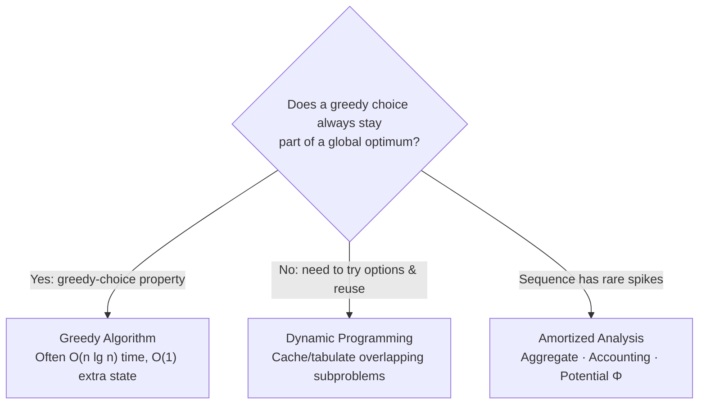

# Advanced Design & Analysis

## Introduction
Once you know basic sorting and trees, Part IV of CLRS teaches the three most important **algorithm design paradigms** in computer science: **Dynamic Programming (DP)**, **Greedy Algorithms**, and **Amortized Analysis**. These aren't single algorithms—they are reusable ways to think when brute force takes $O(2^n)$ or $O(n!)$ time, or when one occasional expensive step hides inside a sequence of fast operations.

## What Problem Is It Solving?
- **Overlapping subproblems & optimal substructure (Dynamic Programming):** Solve exponential search problems in polynomial time by caching/tabulating subproblem answers instead of recomputing them ([Rod Cutting](#/rod_cutting), [Matrix-Chain Multiplication](#/matrix_chain), [Longest Common Subsequence](#/lcs), [Edit Distance](#/edit_distance), [0-1 Knapsack](#/knapsack_01), [Optimal BST](#/optimal_bst), [Seam Carving](#/seam_carving)).
- **Locally optimal irrevocable choices (Greedy Algorithms):** Skip the DP table completely when picking the locally best choice at each step never paints you into a corner ([Activity Selection](#/activity_selection), [Fractional Knapsack](#/fractional_knapsack), [Huffman Codes](#/huffman), [Matroids](#/matroid_greedy)).
- **Average cost per operation over a worst-case sequence (Amortized Analysis):** Prove that even though an operation like resizing a dynamic array (`Vec::push`) occasionally costs $\Theta(n)$, a sequence of $n$ pushes still takes $\Theta(n)$ total—$O(1)$ amortized per push ([Binary Counter](#/binary_counter), [Multipop Stack](#/multipop_stack), [Dynamic Tables](#/dynamic_table), [Scapegoat Trees](#/scapegoat_tree)).

## Algorithms & Trade-Offs

| Paradigm / Pair | Complexity | Space | Core Trade-Off |
|---|---|---|---|
| **Top-Down Memoization** vs. **Bottom-Up Tabulation** ([Rod Cutting](#/rod_cutting), [LCS](#/lcs)) | Same asymptotic $O(\text{states} \times \text{transition})$ | Table size (sometimes reducible to 1 row) | Memoization only computes reachable states and reads cleanly like recursion; bottom-up avoids recursion-stack overhead and easily optimizes memory (e.g., keeping only 2 rows in [Edit Distance](#/edit_distance)). |
| [Fractional Knapsack](#/fractional_knapsack) (Greedy) vs. [0-1 Knapsack](#/knapsack_01) (DP) | $O(n \lg n)$ vs. $O(nW)$ | $O(1)$ vs. $O(W)$ | Allowing fractions lets you greedily take highest value/weight items; forcing whole items (`0` or `1`) breaks greedy and forces DP (which is pseudopolynomial in capacity $W$, NP-hard in general). |
| [Coin Changing](#/coin_change) (Greedy vs. DP) | $O(k)$ greedy vs. $O(kA)$ DP | $O(1)$ vs. $O(A)$ | Greedy works for US coin denominations `{1, 5, 10, 25}`, **but** silently gives suboptimal answers for arbitrary coin sets like `{1, 3, 4}` summing to `6` (`4+1+1` vs `3+3`). |
| [Longest Increasing Subsequence](#/longest_increasing_subsequence) DP vs. Patience/Binary Search | $O(n^2)$ vs. $O(n \lg n)$ | $O(n)$ | Textbook 2D/1D DP checks every predecessor in $O(n^2)$; maintaining minimum tail values with binary search cuts it to $O(n \lg n)$. |
| [Dynamic Table](#/dynamic_table) Doubling vs. Fixed-Increment Growth | $O(1)$ amortized vs. $\Theta(n)$ amortized | $\le 2\times$ waste | Adding $+100$ slots per resize causes $\Theta(n^2)$ total copies over $n$ pushes! Doubling capacity on full (and halving at $1/4$ load, not $1/2$!) guarantees $O(1)$ amortized cost without thrashing. |
| [Binary Reflected Gray Code](#/gray_code) vs. [Binary Counter](#/binary_counter) | $O(1)$ amortized flips/step | $O(n)$ bits | Standard counting flips up to $n$ bits at once (amortized 2 flips); Gray code changes **exactly 1 bit** on every single transition. |

## Quick Rules of Thumb for CS Students
- **Greedy vs. DP exam test:** Always try to construct a small 3-item counterexample where Greedy fails (like coins `{1, 3, 4}` for target `6` or [0-1 Knapsack](#/knapsack_01)). If you find one, you need DP!
- **Why halve at $1/4$ instead of $1/2$ in [Dynamic Table](#/dynamic_table):** If you shrink right at $50\%$ full, alternating `push`/`pop` at the boundary triggers an $O(n)$ copy on *every* operation—hysteresis between $1/4$ and $1$ keeps the potential function balanced.
- **Amortized $\neq$ Average-case:** Probabilistic analysis averages over random inputs/coin flips; **amortized analysis** has zero probability—it guarantees the total cost of *any* worst-case sequence of operations.
