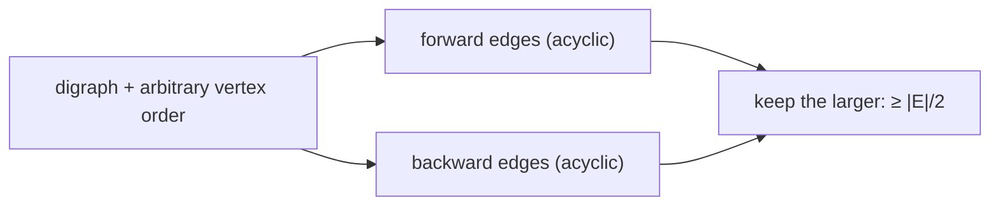

# Acyclic Subgraphs

## What it is
Given a graph, which edges can we keep so that the remaining subgraph is **acyclic**? Problem 17-2 of the first edition (the 2nd edition's greedy problem set) looks at both versions; the directed version is the *maximum acyclic subgraph* problem — equivalent to the minimum **feedback arc set**, which is NP-hard.

## How it works
* **Undirected.** A maximum acyclic subgraph is any **spanning forest** with `|V| − c` edges (`c` = number of connected components): a forest on a component with `k` vertices has at most `k − 1` edges, and greedy edge insertion with [union-find](#/disjoint_set) reaches that bound. This is the [graphic matroid](#/matroid_greedy) — every maximal independent set has the same size.
* **Directed.** Order the vertices arbitrarily (here by index). The *forward* edges (`u < v`) form a DAG, and so do the *backward* edges (`u > v`) — any cycle would have to use both kinds. The larger of the two contains **at least `|E|/2` edges**: a 2-approximation for the NP-hard maximum acyclic subgraph (and a trivial ½-approximation for MAX-ACYCLIC-SUBGRAPH). Better orders via local search or [LP/SDP](#/simplex) improve it.

## Complexity
Undirected `O(E α(V))`; directed `O(V + E)` for the ½-guarantee, exponential for the exact optimum.

## When to use it
Breaking cycles in dependency graphs by deleting few edges, ordering/ranking problems (tournament ranking), layered graph drawing (cycle removal step of Sugiyama's algorithm).

## In this implementation
Tests verify the half guarantee and acyclicity against exhaustive search over vertex orders (so `OPT/2 ≤ ALG ≤ OPT`), and that undirected forests have exactly `n − components` edges and are maximal.
