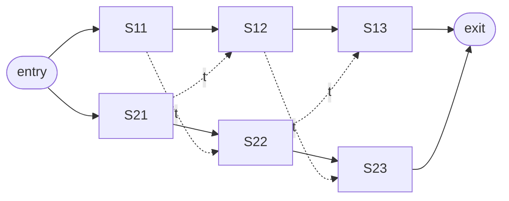

# Assembly-Line Scheduling

## What it is
A factory has two assembly lines with `n` stations each. Station `S_{i,j}` takes time `a_{i,j}`; a chassis may stay on its line or pay a transfer time `t_{i,j}` to move to the other line after station `j`. There are entry (`e_i`) and exit (`x_i`) times. Which stations should be chosen from each line to minimise total time? This was the introductory dynamic-programming example of the 2nd edition; the 3rd edition replaced it with [rod cutting](#/rod_cutting).

## How it works
Let `f_i[j]` be the fastest time to get a chassis through station `S_{i,j}`:

`f_1[j] = min( f_1[j−1] + a_{1,j},  f_2[j−1] + t_{2,j−1} + a_{1,j} )`

and symmetrically for line 2. Bruteforce examines `2ⁿ` subsets of stations; the DP computes both `f` rows in Θ(n) and records which line was used (`l_i[j]`) to reconstruct the path.

## Complexity
Θ(n) time and space versus Θ(2ⁿ) for enumeration.

## When to use it
It is the simplest example of a DP on a *layered DAG* — the same pattern as shortest paths in a [DAG](#/dag_shortest_paths), Viterbi decoding or pipeline scheduling.

## In this implementation
The book's Figure 15.2 instance (fastest time 38, path S1,1 → S2,2 → S1,3 → S2,4 → S2,5 → S1,6) is a test; a brute-force enumerator validates random instances up to 9 stations.
