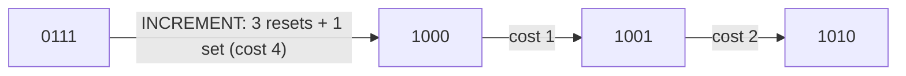

# Amortized Analysis: Binary Counter

## What it is
**Amortized analysis** averages the cost of a *sequence* of operations, giving a bound per operation that holds even for the worst-case sequence (no probability involved). The `k`-bit binary counter is the book's showcase: a single `INCREMENT` may flip `k` bits (`0111…1 → 1000…0`), yet `n` increments cost only `O(n)` in total.

## How it works
Three methods prove the same bound:
1. **Aggregate**: bit `i` flips once every `2^i` increments, so the total is `Σ ⌊n/2^i⌋ < 2n`.
2. **Accounting**: charge **2 credits** per increment — 1 pays for setting a bit to 1, the other is stored on that bit to pay for resetting it to 0 later.
3. **Potential**: let `Φ` = number of 1-bits. An increment that resets `t` bits has actual cost `t + 1` and changes `Φ` by `1 − t`, so the amortized cost is `(t+1) + (1−t) = 2`.

Exact total after `n` increments: `2n − (number of 1-bits in n)`.

## Complexity
Amortized O(1) per increment; worst-case single operation Θ(k). (Allowing decrement too breaks it: alternating `+1/−1` around `2^k` costs Θ(k) each — Exercise 17.1-3.)

## When to use it
Reasoning about [dynamic tables](#/dynamic_table), [Fibonacci heaps](#/fibonacci_heap), [disjoint-set forests](#/disjoint_set), and anything with an expensive-but-rare reorganisation step.

## In this implementation
`BinaryCounter` records actual cost; `amortized_cost` uses the potential method; the tests prove `≤ 2` per increment and the exact `2n − popcount(n)` identity.
