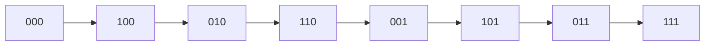

# Bit-Reversed Binary Counter

## What it is
The **iterative FFT** ([FFT, iterative](#/fft_iterative)) starts by permuting its input into **bit-reversed** order: element `k` goes to position `rev(k)`, the number whose binary representation is `k`'s read backwards. Problem 17-1 asks for a counter that steps through the bit-reversal permutation directly, in `O(1)` amortised time per step, so that the permutation of `n = 2^k` elements costs `Θ(n)`.

## How it works
Store the counter as an array `A[0..k)` with `A[i]` of weight `2^i`. The ordinary `INCREMENT` ([binary counter](#/binary_counter)) scans from the *least* significant bit upwards, clearing 1s and setting the first 0. **BIT-REVERSED-INCREMENT** is its mirror image: it scans from the **most significant** position downward — clear the run of leading 1s, set the first 0:

```
BIT-REVERSED-INCREMENT(A):
  i = k−1
  while i ≥ 0 and A[i] = 1: A[i] = 0; i = i − 1
  if i ≥ 0: A[i] = 1
```
Starting at 0 the successive values are `0, 2^{k−1}, 2^{k−2}, 2^{k−2}+2^{k−1}, …` — exactly `rev_k(0), rev_k(1), rev_k(2), …` (for `k = 3`: `0, 4, 2, 6, 1, 5, 3, 7`). The [amortised analysis](#/binary_counter) of the ordinary counter carries over unchanged (the potential is the number of 1-bits): total cost over `n` increments is `O(n)`.



## Complexity
`O(1)` amortised per increment, `Θ(n)` for the whole permutation (versus `Θ(n lg n)` if `rev(k)` is recomputed bit by bit for each `k`).

## When to use it
Preparing in-place FFTs and number-theoretic transforms, and any divide-and-conquer iteration that visits leaves in bit-reversed order.

## In this implementation
`bit_reversal_permutation(k)` is verified against the `rev` function of the FFT module for `k = 1…10`, and the flip count is checked to stay below `2n`.
