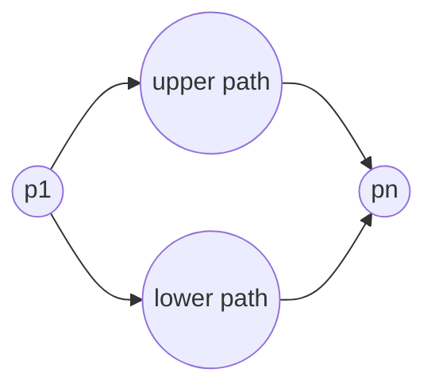

# Bitonic Euclidean Traveling Salesman

## What it is
The general Euclidean travelling-salesman problem is NP-hard. J. L. Bentley suggested restricting to **bitonic tours**: tours that start at the leftmost point, go strictly rightwards to the rightmost point, and then strictly leftwards back. Problem 15-3 shows that the optimal bitonic tour can be found in `O(n²)`.

## How it works
Sort the points by `x` and think of the tour as **two disjoint paths** (upper and lower) that both start at `p₁`. Define `b[i,j]` for `i < j` as the shortest such pair of paths that together visit all of `p₁…p_j`, one ending at `p_i` and the other at `p_j`. Then

* `b[i, j] = b[i, j−1] + |p_{j−1} p_j|` for `i < j−1` (the point `p_j` extends the path that already contains `p_{j−1}`), and
* `b[j−1, j] = min_{k<j−1} ( b[k, j−1] + |p_k p_j| )`.

The answer is `b[n−1, n] + |p_{n−1} p_n|`.

## Complexity
Θ(n²) time and Θ(n²) space (O(n) space is also possible). The restriction is what makes the problem polynomial.

## When to use it
Circuit-board drilling when a one-pass sweep is acceptable, and as an illustration of how structure turns an NP-hard problem into DP. For unrestricted tours see the [approximation algorithm for TSP](#/approx_tsp).

## In this implementation
`bitonic_tour_length` is the DP; `bitonic_tour_brute_force` enumerates all `2^{n−2}` upper/lower assignments to validate it for up to 10 points.
