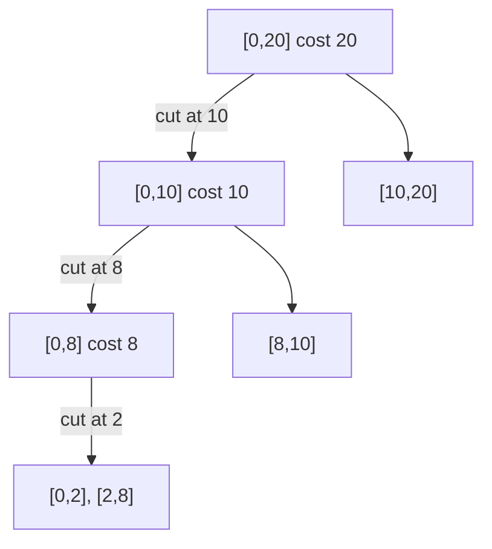

# Breaking a String

## What it is
A language library offers an operation that splits a string at one position and costs time proportional to the **length of the string being split**. Given a string of `n` characters and `m` positions where it must be broken into pieces, in which order should the cuts be made to minimise the total cost? Problem 15-9 (3rd edition) asks for an `O(m³)` dynamic program.

## How it works
Add the endpoints `0` and `n` to the sorted cut positions, giving boundaries `b₀ < b₁ < … < b_{m+1}`. Let `C[i, j]` be the cheapest way to make all cuts strictly between `bᵢ` and `bⱼ`. The *first* cut in that segment, at `b_k`, costs the segment's length, and afterwards the two halves are independent:

`C[i, j] = (b_j − b_i) + min_{i<k<j} ( C[i, k] + C[k, j] )`,  `C[i, i+1] = 0`.

This is the same interval structure as [matrix-chain multiplication](#/matrix_chain) and [optimal BSTs](#/optimal_bst).

For the book's example (length 20, cuts at 2, 8, 10) the best order costs 38, while cutting left to right costs 20+18+12 = 50.

## Complexity
`Θ(m³)` time, `Θ(m²)` space.

## When to use it
Planning splits of ropes/files/arrays with linear-cost splits, divide-and-conquer scheduling, and any problem whose optimal solution is a binary tree over a sequence.

## In this implementation
The DP also reconstructs an optimal order; tests compare with exhaustive search over **all** cut orders (up to 6 cuts) and verify the reported order's cost by simulation.
