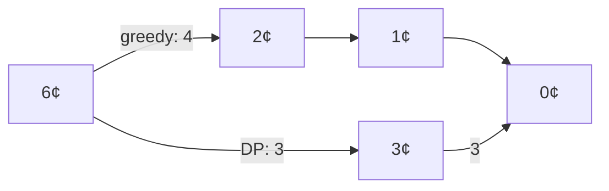

# Coin Changing

## What it is
Make change for `n` cents using the fewest coins. Problem 16-1 asks you to:
1. give a greedy algorithm for US coins (quarter, dime, nickel, penny) and prove it optimal;
2. show the greedy algorithm is also optimal when the coins are powers of an integer `c`: `c⁰, c¹, …, cᵏ`;
3. give a set of denominations (including a penny) for which greedy is **not** optimal — e.g. `{1, 3, 4}` for 6 cents (greedy: 4+1+1; optimal: 3+3);
4. give an `O(nk)` dynamic program that works for *any* denominations.

## How it works
**Greedy:** take the largest coin not exceeding the remaining amount. For powers of `c`, an optimal solution uses fewer than `c` coins of each smaller denomination (otherwise `c` of them could be replaced by one larger coin), which forces it to agree with greedy.

**DP:** `best[v] = 1 + min_{coin ≤ v} best[v − coin]`.

## Complexity
Greedy Θ(k) after sorting; DP Θ(n·k) for amount `n` and `k` denominations.

## When to use it
Cash registers (most real currencies are "canonical", meaning greedy is optimal), and as the classic example of *when greedy fails*, motivating dynamic programming (cf. [0-1 knapsack](#/knapsack_01)).

## In this implementation
`greedy_change`, `dp_change` and `power_coins`; the tests verify greedy = DP for powers of 2…5 and the US system, and exhibit the `{1,3,4}` counterexample.
