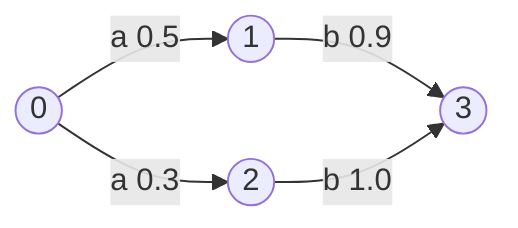

# More DP: Company Party & Viterbi

## What it is
Two classic DP exercises from the problem sets of Chapter 15.

**Planning a company party (Problem 15-6).** The company hierarchy is a tree; each employee has a conviviality rating. Invite a set of employees with maximum total rating so that nobody is invited together with their **direct supervisor** — a maximum-weight *independent set in a tree*.

**Viterbi algorithm (Problem 15-7).** A speech-recognition system is a directed graph whose edges carry a sound `σ` and a probability `p`. Given a sequence of sounds, find the most probable path from the start vertex that spells it — the heart of hidden Markov model decoding.

## How it works
*Party.* For each vertex keep two numbers: `with[v] = rating[v] + Σ without[child]` and `without[v] = Σ max(with[child], without[child])`; the answer is `max(with[root], without[root])`. A top-down pass reconstructs the guest list.

*Viterbi.* `best[i][v]` is the maximum probability of a path of length `i` ending in `v` that spells `σ₁…σᵢ`:

`best[i][v] = max_{(u,v) with label σᵢ} best[i−1][u] · p(u,v)`.

Back-pointers recover the path; `O(k·E)` for a `k`-symbol observation.

## Complexity
Party: Θ(n). Viterbi: Θ(k·|E|) time, Θ(k·|V|) space.

## When to use it
Tree DP appears in network design and dependency resolution; Viterbi is used in speech recognition, part-of-speech tagging, convolutional-code decoding and gene finding.

## In this implementation
Both are tested: the party DP against exhaustive subset enumeration on random trees, Viterbi on a small hand-checked graph (best path probability 0.45).
