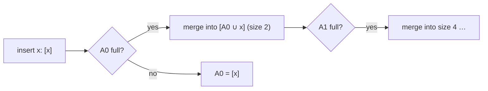

# Dynamic Binary Search

## What it is
Binary search is fast on a sorted array but insertion into a sorted array costs `Θ(n)`. Problem 17-2 shows how to support `SEARCH` and `INSERT` on a *dynamic* set with only logarithmic cost by keeping **several** sorted arrays — the **logarithmic method** of Bentley and Saxe for turning static structures into dynamic ones.

## How it works
Let `n`'s binary representation be `⟨n_{k−1}, …, n₀⟩`. Keep `k` arrays `A₀, …, A_{k−1}`, where `A_i` has length `2^i` and is sorted if `n_i = 1`, and is empty otherwise. The arrays are independent (no ordering between them).
* **SEARCH:** binary-search each non-empty array: `Θ(lg n)` arrays × `O(lg n)` each = `O(lg² n)`.
* **INSERT:** exactly [the binary-counter increment](#/binary_counter) — create a size-1 array and, while `A_i` is full, **merge** it with the carried array (cost `Θ(2^i)`) into the next array. Worst case `Θ(n)` but **amortised `O(lg n)`**: each element takes part in at most `lg n` merges (each merge moves it into a bigger array), by the aggregate method.
* **DELETE (part d):** remove the element from its array `A_i`, move one element from the *smallest* non-empty array `A_j` into the hole (keeping `A_i` sorted), and split what is left of `A_j` (`2^j − 1` elements) into arrays of sizes `1, 2, …, 2^{j−1}` — restoring the invariant.

## Complexity
Search `O(lg² n)`; insert `O(lg n)` amortised; delete `O(lg n)` amortised (worst case `Θ(n)`).

## When to use it
Log-structured merge trees (LSM trees in databases like LevelDB/RocksDB), append-heavy indexes, and making any *static* sorted structure (suffix arrays, k-d trees) dynamic.

## In this implementation
`DynamicSet::validate` checks the invariant `|A_i| = 2^i` iff bit `i` of `n` is set; tests run 4000 random insert/delete operations against `BTreeSet` and verify the array count equals `popcount(n)` after every insert.
