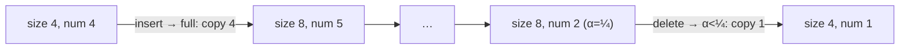

# Amortized Analysis: Dynamic Tables

## What it is
A **dynamic table** (like C++ `std::vector` or Java `ArrayList`) grows when it is full and shrinks when it becomes sparse, so its memory use stays proportional to the number of stored items while insertions and deletions remain cheap *on average*. Section 17.4 analyses the strategy with the potential method.

## How it works
* **Expansion:** `TABLE-INSERT` into a full table allocates a table twice as large, copies the `num` items (cost `num`) and inserts the new item.
* **Contraction:** `TABLE-DELETE` halves the table when the load factor `α = num/size` would drop **below ¼** (not below ½ — contracting at ½ would let alternating insert/delete thrash with Θ(n) cost each time).
* **Potential:** `Φ(T) = 2·num − size` if `α ≥ ½`, and `size/2 − num` if `α < ½`. It is 0 right after a resize, so a costly resize is paid for by earlier cheap operations.

Result: every operation has amortized cost at most **3** (insert: actual 1 plus ΔΦ ≤ 2; resize: actual `num+1` offset by ΔΦ = `−num + 2`).

## Complexity
Amortized Θ(1) per insert/delete; a single operation can cost Θ(n) while resizing. Space ≤ 4× the number of items.

## When to use it
Every growable array, hash-table resizing ([chained](#/chained_hash_table), [open addressing](#/open_addressing)), string builders and I/O buffers. Growth factors other than 2 (e.g. 1.5) trade copying cost against slack space.

## In this implementation
`DynamicTable` counts every copy/insert/delete as cost units, exposes the potential `Φ`, and the tests verify `total_cost ≤ 3 × operations` for sequences of inserts and random mixed operations, along with the load-factor invariant `¼ ≤ α ≤ 1`.
