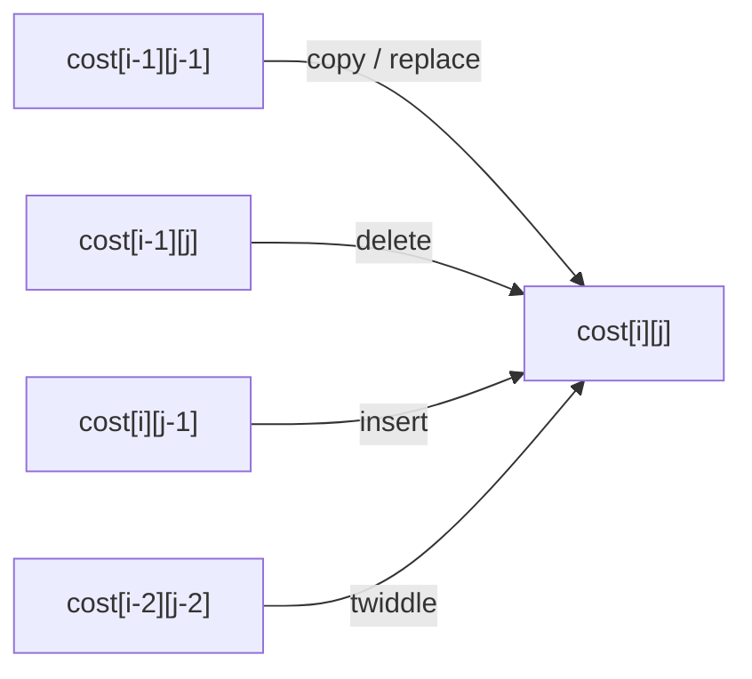

# Edit Distance

## What it is
Problem 15-5 generalises the Levenshtein distance: transform a source string `x` into a target `y` using six operations, each with its own cost, and find the cheapest sequence — the basis of spelling correction and DNA sequence alignment.

| Operation | Effect |
|---|---|
| copy | copy a character of `x` to `z` (cost may be 0) |
| replace | replace a character of `x` with another |
| delete | skip a character of `x` |
| insert | insert a character of `y` |
| twiddle | swap the next two characters of `x` |
| kill | delete the entire rest of `x` (only as the last operation) |

## How it works
`cost[i,j]` = cheapest way to turn `x[1..i]` into `y[1..j]`:

`cost[i,j] = min( copy/replace from [i−1,j−1], delete from [i−1,j], insert from [i,j−1], twiddle from [i−2,j−2] if x_i x_{i-1} = y_{j-1} y_j )`

and the answer is `min(cost[m,n], min_i cost[i,n] + kill)`. Recording which operation won lets us print the **edit script**; the DP table is also a shortest-path problem in a grid DAG.

The problem also shows that **sequence alignment** (match +1, mismatch −1, gap −2) is the same DP with different costs.

## Complexity
Θ(mn) time and space (Θ(min(m, n)) space for the distance only).

## When to use it
Spell checkers, fuzzy search, `diff`, DNA/protein alignment (Needleman–Wunsch), OCR post-correction. Related: [LCS](#/lcs).

## In this implementation
`edit_distance(x, y, &Costs)` returns the cost and an operation list; `apply` replays a script to verify it produces `y`. Levenshtein results are cross-checked with a reference implementation.
