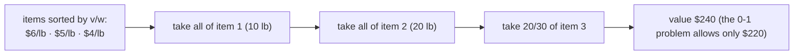

# Fractional Knapsack

## What it is
The **fractional knapsack** problem is the "divisible goods" version of [0-1 knapsack](#/knapsack_01): the thief may take any fraction of an item (gold dust rather than gold bars). Section 16.2 uses the pair to illustrate when a greedy strategy works and when dynamic programming is required.

## How it works
Greedy rule: sort items by value per unit weight `vᵢ/wᵢ` (descending) and take as much of each as will fit.

**Why it is optimal:** suppose an optimal solution leaves some of a higher-ratio item while carrying a lower-ratio one; swapping a small weight `δ` from the lower to the higher item strictly increases value (greedy-choice property) — an exchange argument.

## Complexity
Θ(n lg n) for the sort; Θ(n) with a linear-time selection of the "split" item ([weighted median](#/weighted_median)).

## When to use it
Divisible resources: bandwidth sharing, blending ingredients, LP relaxation bounds inside branch-and-bound for 0-1 knapsack. Its value is always an upper bound on the 0-1 optimum.

## In this implementation
Floating-point weights/values; tests check feasibility and the bound against the exact 0-1 DP.
