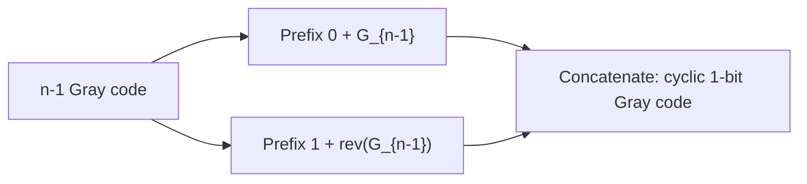

# Binary Reflected Gray Code

## What it is
An **$n$-bit binary reflected Gray code** orders all $2^n$ binary words so that consecutive codewords (as well as the last and first) differ in **exact Hamming distance 1**. Unlike a standard [binary counter](#/binary_counter), where increments can flip $\Theta(n)$ bits at powers of two, each transition in a Gray code flips only a single bit.

## How it works
* **Recursive reflection (`gray_recursive`)**: Start with `[0]` for $n=0$. For $n \ge 1$, list the $(n-1)$-bit Gray code prefixed with `0`, followed by its **reverse** prefixed with `1`. Only the middle seam toggles the MSB while every other step inherits the single-bit flip of $n-1$.
* **Closed-form encoding & decoding (`gray_encode`, `gray_decode`)**: Word $i$ maps directly to $G(i) = i \oplus \lfloor i / 2 \rfloor$. Decoding recovers $i$ via prefix XOR across right-shifted bit slices.
* **Single-bit transition schedule (`gray_transition_positions`)**: Transition $i \to i+1$ flips bit index $\operatorname{tz}(i+1)$ (the lowest `0` bit of $i$, or trailing zeros of $i+1$). Computing the index by scanning from LSB takes $\operatorname{tz}(i+1)+1$ probes, summing across $0 \le i < 2^n - 1$ to at most $2 \cdot 2^n$ operations — i.e., $O(1)$ amortized work per step.

## Complexity
* **Closed-form encode/decode**: $O(1)$ word-level bit operations ($O(\lg w)$ shifts for $w$-bit words).
* **Full $2^n$ traversal**: $\Theta(2^n)$ total bit probes and single-bit updates — $O(1)$ amortized per codeword.

## When to use it
For rotary encoders, Karnaugh map minimization, error-resilient state counters, and amortized subset/gray-order combinatorial generation where each adjacent subset adds or removes a single element.

## In this implementation
`gray_recursive`, `gray_encode`, `gray_decode`, and `gray_transition_positions` verify equivalence across $n = 0..10$, cyclic Hamming distance $1$, and the exact $\le 2 \cdot 2^n$ amortized inspection bound up to $n = 12$.
