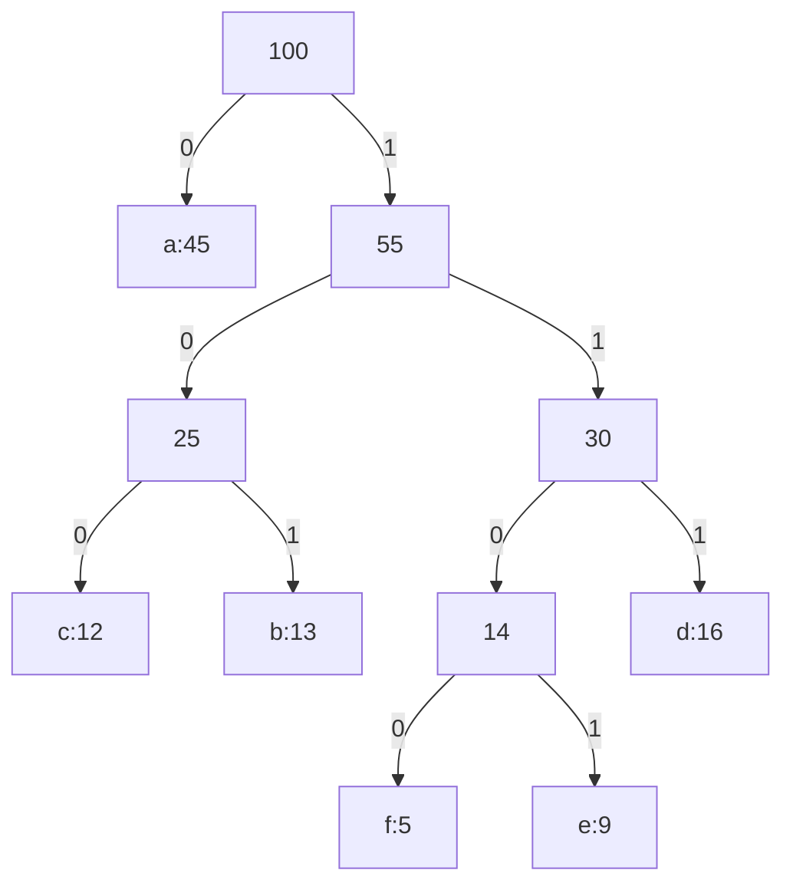

# Huffman Codes

## What it is
A **prefix code** assigns each character a bit string such that no codeword is a prefix of another, so an encoded message can be decoded unambiguously left to right. **Huffman's algorithm** constructs an *optimal* prefix code — the one minimising the total encoded length `B(T) = Σ f(c)·d_T(c)` — and typically saves 20–90 % over fixed-length codes.

## How it works
Treat the code as a binary tree whose leaves are characters (left edge = 0, right edge = 1). Start with `n` leaves in a min-priority queue keyed by frequency; repeat `n−1` times: extract the two lowest-frequency nodes `x, y`, create a parent with frequency `f(x)+f(y)` and put it back. The last remaining node is the root.

**Correctness.** *Greedy choice* (Lemma 16.2): the two least frequent characters are siblings at maximum depth in some optimal tree (exchange argument). *Optimal substructure* (Lemma 16.3): merging them into a single symbol yields a problem whose optimal tree gives an optimal tree for the original.

## Complexity
`O(n lg n)` with a binary heap (`O(n lg lg n)` with a van Emde Boas tree; `O(n)` if frequencies are pre-sorted using two queues).

## When to use it
DEFLATE/zip/gzip, JPEG and MP3 entropy coding stages, and any symbol-compression with known statistics. Arithmetic coding or ANS get closer to the entropy bound for skewed distributions.

## In this implementation
Arena-based tree with a `BinaryHeap<Reverse<(freq, id)>>`; `encode`/`decode` round-trip messages, and the tests verify prefix-freeness and the book's example (224 bits for 100 symbols).
