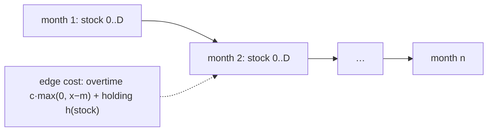

# Inventory Planning

## What it is
The Rinky Dink Company makes machines whose monthly demand `d_i` is known `n` months ahead; `D = Σ d_i`. A full-time staff can build up to `m` machines per month; building more requires part-time labour at `c` dollars per extra machine. Unsold machines at the end of a month cost `h(j)` for `j` machines in stock (`h` non-decreasing). Problem 15-11 asks for a production plan of minimum cost, in time polynomial in `n` and `D`.

## How it works
**Optimal substructure:** the best plan for the first `i` months that ends with `j` machines in stock is built from the best plan for `i−1` months ending with `j′` machines, plus this month's production `x = j + d_i − j′ ≥ 0`.

`F[i, j] = min_{j′} ( F[i−1, j′] + c·max(0, x − m) + h(j) )` with `x = j + d_i − j′`.

The state space has `n(D+1)` entries and each takes `O(D)` to evaluate: `O(n D²)` time. The answer is `min_j F[n, j]` (stock after the last month is never useful, so `j = 0` is optimal), and back-pointers give the plan.

## Complexity
`O(n·D²)` time, `O(n·D)` space; with convex costs a faster greedy/flow solution exists.

## When to use it
Production planning, supply-chain lot sizing (the Wagner–Whitin problem), battery/storage scheduling, and capacity planning with carry-over costs.

## In this implementation
`plan` returns cost and monthly production; `evaluate` replays any plan. Tests compare with an exhaustive recursion on random small instances and check that free storage levels the production at regular capacity (no overtime).
