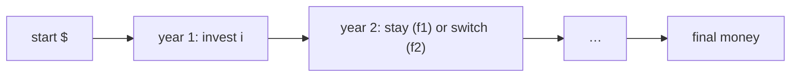

# Planning an Investment Strategy

## What it is
You have `$10 000` to invest over ten years among `n` investments whose **return rates `r_{ij}` are known in advance** for every year `j`. Each year you decide where your money sits. Leaving it in the same investment costs a fee `f₁`; moving it costs the larger fee `f₂ > f₁`. Problem 15-10 walks through the DP design: (a) show an optimal strategy keeps *all* money in a single investment each year, (b) show optimal substructure, (c) give the algorithm, (d) show that a cap of `$15 000` per investment destroys optimal substructure.

## How it works
Because money in one investment earns a linear return, a convex combination of strategies is never better than the best pure one — hence (a). With all money in investment `i` during year `j`, let `best[j][i]` be the maximum final money after year `j`:

`best[j][i] = max( (best[j−1][i] − f₁)·r_{ji},  max_{k≠i} (best[j−1][k] − f₂)·r_{ji} )`.

Linearity also gives optimal substructure: more money earlier is never worse later (the recurrence is monotone). Computing `max_{k≠i}` naively costs `O(n)`; keeping the **two best** previous values makes it `O(1)`, so the whole plan costs `O(n·y)`. With a per-investment cap the amount invested affects *which* options are feasible, so the best amount in year `j−1` is no longer simply the largest — optimal substructure fails.

(This module models the initial deposit as a "switch" into the first investment.)

## Complexity
`O(n·y)` time with the two-best trick (`O(n²y)` naive), `O(n·y)` space for the strategy.

## When to use it
Planning with known (or forecast) rates, tax-lot and asset-allocation toy models, and as an example of a DP where **linearity** justifies optimal substructure while a nonlinear restriction breaks it.

## In this implementation
`best_strategy` returns the final money and the plan; `simulate` replays any plan. Tests compare with exhaustive search over all `nʸ` plans on 100 random instances.
