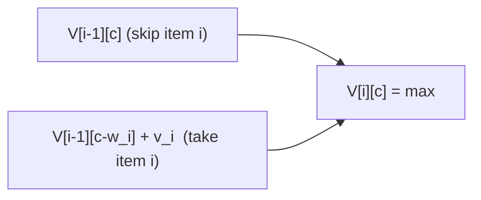

# 0-1 Knapsack

## What it is
A thief finds `n` items; item `i` is worth `v_i` dollars and weighs `w_i`. The knapsack holds at most weight `W`. Choose a subset (each item taken whole or left) maximising value. Section 16.2 contrasts this **0-1 knapsack**, which needs dynamic programming and is NP-hard, with the [fractional knapsack](#/fractional_knapsack), which a greedy rule solves.

## How it works
`V[i, c]` = best value using the first `i` items with capacity `c`:

`V[i,c] = max( V[i−1, c],  V[i−1, c−w_i] + v_i )`  (second option only if `w_i ≤ c`).

The table has `(n+1)(W+1)` entries; trace back from `V[n, W]` to find the chosen set.

Greedy-by-ratio fails: with items (10 lb, $60), (20 lb, $100), (30 lb, $120) and `W = 50`, taking the best ratio first gives $160, but the optimum is $220 (items 2 and 3).

## Complexity
Θ(nW) time — **pseudo-polynomial** because `W` is exponential in its bit-length (the problem is NP-hard; see [subset sum](#/subset_sum_np) and its [FPTAS](#/approx_subset_sum)).

## When to use it
Resource budgeting, cargo loading, portfolio selection with small integer budgets.

## In this implementation
Table-based DP with item reconstruction, plus an unbounded-knapsack variant. Randomised tests compare against exhaustive subset enumeration.
