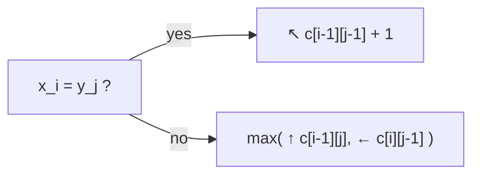

# Longest Common Subsequence

## What it is
A **subsequence** of a string keeps its characters in order but may skip some. The *longest common subsequence* of `X` and `Y` has applications in DNA comparison (`GTCGTTCGGAATGCCGTTGCTCTGTAAA` vs `GGCTCGCAACTA…`), version control (`diff`) and plagiarism detection.

## How it works
Optimal substructure (Theorem 15.1): let `Z = LCS(X_m, Y_n)`.
* If `x_m = y_n`, then `z` ends with that symbol and `Z_{k−1} = LCS(X_{m−1}, Y_{n−1})`.
* Otherwise `Z` is the longer of `LCS(X_{m−1}, Y)` and `LCS(X, Y_{n−1})`.

So `c[i,j] = c[i−1,j−1] + 1` if the symbols match, else `max(c[i−1,j], c[i,j−1])`. Trace back from `c[m,n]` following the arrows to rebuild the LCS.

Using only two rows computes the *length* in `O(min(m,n))` space; reconstructing the string with less than quadratic space needs Hirschberg's divide-and-conquer.

## Complexity
Θ(mn) time and space (length only: Θ(min(m, n)) space).

## When to use it
Diff tools, bioinformatics sequence alignment, spell correction (related to [edit distance](#/edit_distance)), and as a building block for [longest increasing subsequence](#/longest_increasing_subsequence) (LCS of a sequence with its sorted copy).

## In this implementation
Table construction, backtracking, a two-row length routine and memoization; random small strings are verified against a subset-enumeration brute force.
