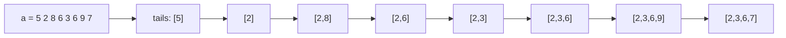

# Longest Monotonically Increasing Subsequence

## What it is
Given a sequence of numbers, find the longest subsequence whose values strictly increase. Exercises 15.4-5 and 15.4-6 and Problem 15-4 develop a Θ(n²) solution (via [LCS](#/lcs) with the sorted copy of the sequence, or directly) and then a Θ(n lg n) one.

## How it works
**Quadratic DP.** `len[i] = 1 + max{ len[j] : j < i, a[j] < a[i] }`; remember the predecessor to rebuild the sequence.

**Patience-sorting / binary search (Exercise 15.4-6).** Maintain `tails[k]`, the smallest possible last value of an increasing subsequence of length `k+1`. This array is always sorted, so for each new element we binary-search the first tail `≥ a[i]` and overwrite it (or append if none). The number of tails at the end is the LIS length; storing predecessor links recovers one witness.

## Complexity
Quadratic DP Θ(n²) time; binary-search version Θ(n lg n) time, Θ(n) space.

## When to use it
Patience sorting of card piles, version-control merge heuristics, scheduling of nested boxes/envelopes, and the Robinson–Schensted correspondence with [Young tableaux](#/young_tableau).

## In this implementation
Both algorithms return an actual subsequence (not just its length). Random small arrays are verified against a subset-enumeration brute force.
