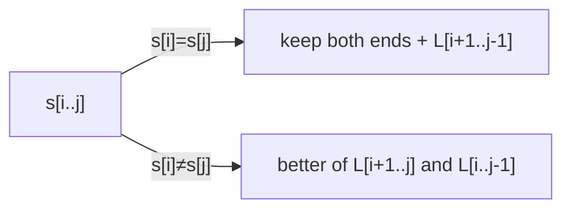

# Longest Palindromic Subsequence

## What it is
Problem 15-2 asks for an `O(n²)` algorithm that finds the longest subsequence of a string that is a **palindrome**. For example `character` → `carac`. It is an *interval* dynamic program, close in spirit to [LCS](#/lcs) (indeed LPS(s) = LCS(s, reverse(s))).

## How it works
Let `L[i,j]` be the length of the longest palindromic subsequence of `s[i..j]`:

* `L[i,i] = 1`
* if `s[i] = s[j]`: `L[i,j] = L[i+1,j−1] + 2`
* otherwise `L[i,j] = max(L[i+1,j], L[i,j−1])`

Fill by increasing substring length; walk the table from `(0, n−1)` inward, emitting matching pairs for the two ends.

## Complexity
Θ(n²) time and space.

## When to use it
Minimum insertions/deletions to make a string a palindrome (`n − L`), DNA hairpin (stem-loop) detection, and as the standard example of interval DP.

## In this implementation
`longest_palindromic_subsequence` returns an actual palindrome; the tests verify it is a palindrome, a subsequence of the input, and of optimal length (via exhaustive subset enumeration on random binary strings).
