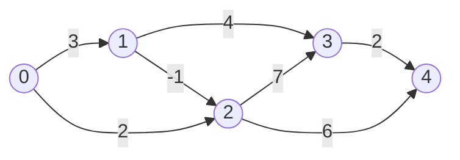

# Longest Simple Path in a DAG

## What it is
The **longest simple path** problem asks for the path of greatest weight between two vertices that repeats no vertex. In general graphs it is NP-hard (it contains Hamiltonian path), and it famously does *not* have optimal substructure — Section 15.3 uses the *unweighted* version to show that two optimal sub-paths need not combine into an optimal path because they may share vertices. Problem 15-1 asks you to solve it for **directed acyclic graphs** in linear time.

## How it works
In a DAG no path can revisit a vertex, so the subproblems are independent: let `best[v]` be the weight of the longest path from `s` to `v`. Process the vertices in [topological order](#/topological_sort):

`best[v] = max over edges (u, v) of ( best[u] + w(u, v) )`.

Remember the predecessor to rebuild the path. This is exactly the "critical path" computation of [shortest paths in DAGs](#/dag_shortest_paths) with `max` instead of `min`.

## Complexity
`Θ(V + E)` for the DAG; NP-hard for arbitrary directed or undirected graphs.

## When to use it
Project scheduling (critical path), longest increasing subsequence viewed as a DAG ([LIS](#/longest_increasing_subsequence)), dependency depth in build systems, and any DP whose subproblem graph is acyclic.

## In this implementation
Edge weights may be negative; `None` is returned for cyclic graphs or unreachable targets. Tests compare against exhaustive enumeration of all `s → t` paths on 200 random DAGs with shuffled labels.
