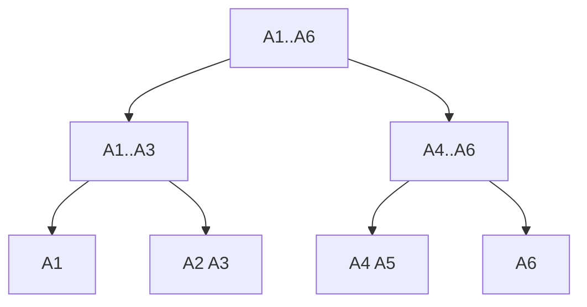

# Matrix-Chain Multiplication

## What it is
Matrix multiplication is associative, but the order matters enormously: multiplying a `10×100`, `100×5` and `5×50` matrix as `(AB)C` costs 7 500 scalar multiplications, whereas `A(BC)` costs 75 000. Given dimensions `p₀,p₁,…,pₙ` (matrix `A_i` is `p_{i−1}×p_i`) find the parenthesization with minimum cost. We only decide the *order*; no matrices are multiplied.

## How it works
Optimal substructure: if the best split of `A_i…A_j` is at `k`, then both sub-chains are parenthesised optimally, giving

`m[i,j] = min_{i≤k<j} ( m[i,k] + m[k+1,j] + p_{i−1}·p_k·p_j )`.

Fill the table by increasing chain length; store the best `k` in `s[i,j]` to print the solution.

Example (Figure 15.5): `p = ⟨30,35,15,5,10,20,25⟩` → `m[1,6] = 15125`, order `((A1(A2A3))((A4A5)A6))`.

## Complexity
Θ(n³) time, Θ(n²) space. The number of parenthesizations is the Catalan number `C_{n−1} = Ω(4ⁿ/n^{3/2})`, so brute force is hopeless. (Hu–Shing gives O(n lg n).)

## When to use it
Optimising chained matrix products in numerical libraries and tensor contractions, query-plan join ordering, and any "interval DP" (optimal BST, polygon triangulation, parsing).

## In this implementation
Bottom-up `matrix_chain_order`, `optimal_parens`, a memoized version and the exponential recursion; all three costs are compared on random chains.
