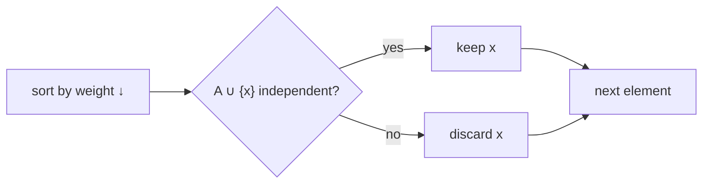

# Matroids & Weighted Greedy

## What it is
A **matroid** `M = (S, ℐ)` is a finite set `S` with a family `ℐ` of "independent" subsets that is *hereditary* (subsets of independent sets are independent) and obeys the *exchange property* (if `|A| < |B|` are independent, some `x ∈ B∖A` has `A ∪ {x}` independent). Sections 16.4–16.5 of the 1st–3rd editions show that matroids are exactly the structures on which the **greedy algorithm** finds maximum-weight independent sets. (They were removed from the 4th edition.)

## How it works
`GREEDY(M, w)`: sort `S` by weight descending; add each element to `A` if `A ∪ {x}` stays independent.

* **Graphic matroid**: independent sets are forests. Greedy = Kruskal's algorithm on maximum weights ⇒ [minimum spanning tree](#/mst_kruskal) after negating weights.
* **Uniform matroid**: any set of ≤ `k` elements.
* **Scheduling matroid**: unit-time tasks with deadlines are independent iff for all `t` the number of tasks with deadline ≤ `t` is at most `t`. Maximising the weight of early tasks = minimising the total late penalty.

Example (Figure 16.7): 7 tasks with deadlines `4,2,4,3,1,4,6` and penalties `70,60,50,40,30,20,10`; greedy keeps tasks 1,2,3,4,7 on time and pays 30 + 20 = **50**.

## Complexity
`O(n lg n + n·f(n))` where `f(n)` is the time of one independence check.

## When to use it
Recognising that a problem is a matroid gives a proof of greedy correctness for free: minimum spanning trees, basis selection in linear algebra, scheduling with deadlines, spanning forests of hypergraphs. For non-matroid problems greedy may fail (e.g. [0-1 knapsack](#/knapsack_01)).

## In this implementation
A `Matroid` trait with graphic, uniform and scheduling instances; tests compare greedy against exhaustive search on random instances.
