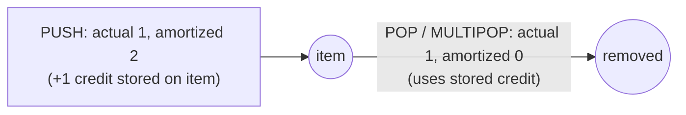

# Amortized Analysis: Stack with MULTIPOP

## What it is
Take an ordinary stack and add `MULTIPOP(S, k)`, which pops the top `k` objects (or the whole stack if it has fewer). A single `MULTIPOP` costs `Θ(min(s, k))`, so a naive bound says `n` operations cost `O(n²)`. Section 17.1 shows the true total is `O(n)`.

## How it works
Each object can be popped (by `POP` or `MULTIPOP`) **at most once per push**. So the total number of pops is bounded by the number of pushes, which is at most `n`; total cost ≤ `2n`.

* **Accounting method:** charge 2 for `PUSH` (1 pays for the push, 1 is stored as credit on the object to pay for its eventual removal) and 0 for `POP` and `MULTIPOP`.
* **Potential method:** `Φ` = number of objects on the stack; `MULTIPOP` of `k'` objects changes `Φ` by `−k'`, cancelling its actual cost.

## Complexity
Amortized O(1) for every operation; the cost of a single `MULTIPOP` can still be Θ(n).

## When to use it
The same "each element pays for its own removal" argument proves linear time for the monotonic-stack trick, for [queue via two stacks](#/stack_queue), for the linked-structure rebuilds inside the [convex hull Graham scan](#/convex_hull_graham), and for the KMP prefix function ([KMP](#/kmp)).

## In this implementation
Costs are counted explicitly; the tests run thousands of random operation sequences and assert `total_cost ≤ 2 × operations`.
