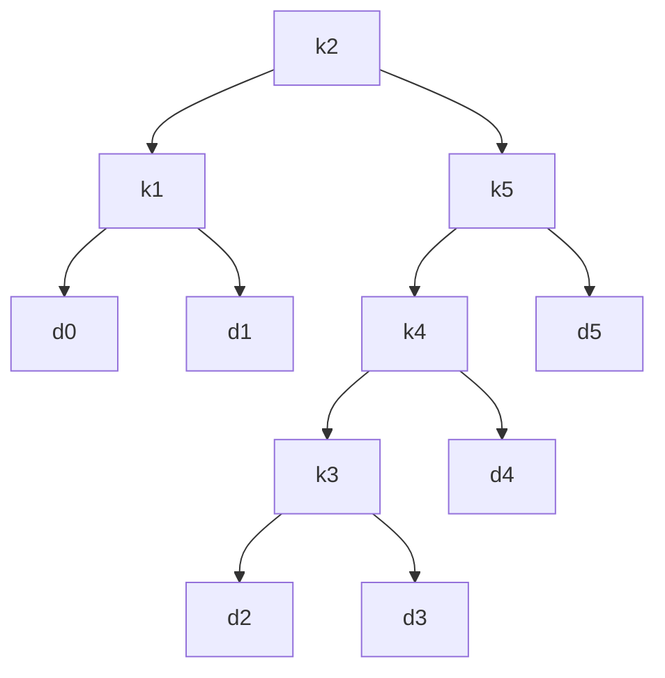

# Optimal Binary Search Trees

## What it is
Given sorted keys `k₁<…<kₙ` with search probabilities `pᵢ` and "gaps" (unsuccessful searches that end at dummy keys `d₀…dₙ`) with probabilities `qᵢ`, build the BST with the **minimum expected search cost** `E = Σ (depth(kᵢ)+1)pᵢ + Σ (depth(dᵢ)+1)qᵢ`. Think of a spell-checker's dictionary or a compiler's keyword table: frequent words should sit near the root, and — unlike [Huffman codes](#/huffman) — the keys keep their sorted order.

## How it works
Choosing `k_r` as the root of keys `i…j` splits the problem into two independent sub-trees, each one level deeper, so the sum of all probabilities `w(i,j)` is added once:

`e[i,j] = min_{i≤r≤j} ( e[i,r−1] + e[r+1,j] + w(i,j) )`, `e[i,i−1] = q_{i−1}`.

Fill by increasing interval length and remember the best `r` in `root[i,j]`. Knuth's observation `root[i,j−1] ≤ root[i,j] ≤ root[i+1,j]` restricts the inner loop and drops the total to Θ(n²).

(Figure 15.10: expected cost 2.75.)

## Complexity
Θ(n³) time, Θ(n²) space; Θ(n²) time with Knuth's refinement.

## When to use it
Static dictionaries with known access frequencies, decision trees, index design. If frequencies change use self-adjusting structures instead.

## In this implementation
Both the cubic DP and Knuth's speed-up, plus a pretty-printer for the resulting tree; the book's example (2.75, root `k2`) is a test.
