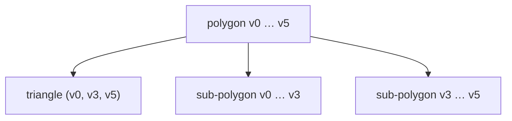

# Optimal Polygon Triangulation

## What it is
A **triangulation** of a convex polygon with `n` vertices is a set of `n − 3` non-crossing chords dividing it into `n − 2` triangles. Given a weight function on triangles (here the perimeter), find the triangulation of minimum total weight. The first edition of CLRS presents this problem in the dynamic-programming chapter to show that it has *exactly the structure* of [matrix-chain multiplication](#/matrix_chain); the later editions dropped the section but kept the idea as an exercise.

## How it works
Fix the polygon's edge `(v_i, v_j)`. In any triangulation it belongs to exactly one triangle `(v_i, v_k, v_j)` with `i<k<j`, which splits the polygon into two smaller polygons:

`t[i,j] = min_{i<k<j} ( t[i,k] + t[k,j] + w(v_i, v_k, v_j) )`,  `t[i,i+1] = 0`.

A parenthesisation of a matrix chain ↔ a triangulation (binary tree with `n−1` leaves ↔ polygon with `n` vertices). The number of triangulations is the Catalan number `C_{n−2}`.

## Complexity
Θ(n³) time, Θ(n²) space.

## When to use it
Mesh generation, finite-element grids, rendering pipelines (minimising total edge length), and parsing ambiguous grammars — all "interval DP" problems.

## In this implementation
`optimal_triangulation` returns the minimum weight and the chosen triangles; tests verify it on a triangle, a square (two equal diagonals), and against a plain recursive search for an octagon.
