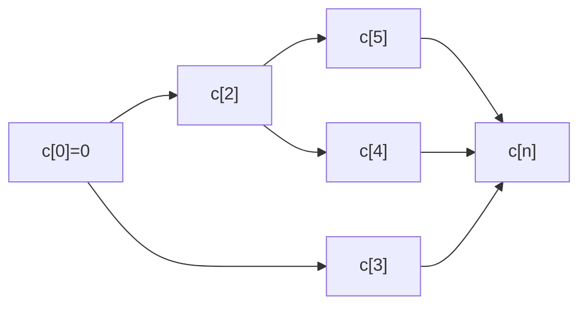

# Printing Neatly

## What it is
Typeset a paragraph of `n` words (lengths `l₁…lₙ`) on lines of at most `M` characters so that the text looks even. If a line holds words `i…j`, the number of extra spaces at its end is `M − j + i − Σ l_k`, and the line costs the **cube** of that number (the last line is free). Minimise the total cost. This is the idea behind Knuth–Plass line breaking in TeX; cubes punish a few very loose lines more than many slightly loose ones.

## How it works
Let `c[j]` be the minimum cost of setting the first `j` words. The last line contains words `i+1…j` for some `i`:

`c[j] = min_{i<j, line fits} ( c[i] + cost(i+1, j) )`.

Record the argmin to rebuild the line breaks. Only `O(M)` candidate starts need examining for each `j`, because a line holds at most `⌈M/2⌉` words.

## Complexity
O(n·M) time, O(n) space (O(n²) without the width cut-off).

## When to use it
Word processors, e-book reflow, caption wrapping; also a template for "optimal segmentation" problems (word break, bin partitioning with convex costs).

## In this implementation
`print_neatly` returns the cost and how many words go on each line; `layout` typesets real words. Tests compare the DP with exhaustive enumeration of all break placements.
