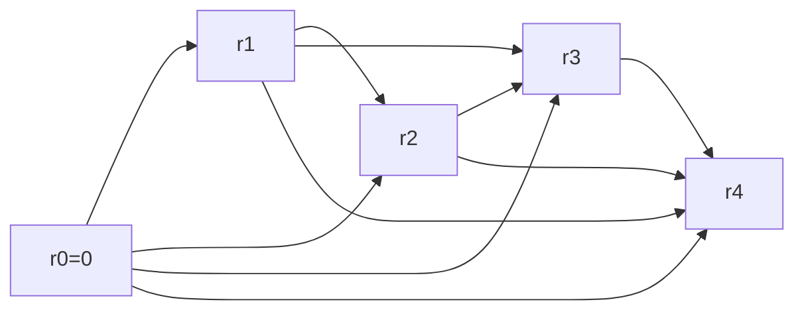

# Rod Cutting

## What it is
Given a rod of length `n` and a table of prices `p_i` for pieces of length `i`, cut the rod (possibly not at all) to maximise total revenue. The 3rd and 4th editions use it as the first dynamic-programming example; the 1st and 2nd editions used assembly-line scheduling instead.

## How it works
**Optimal substructure:** the best revenue satisfies `r_n = max_{1≤i≤n} (p_i + r_{n−i})` — cut off a first piece of length `i` and solve the remainder optimally.

Three ways to evaluate it:
1. **Naive recursion** `CUT-ROD` recomputes the same subproblems: `T(n) = 1 + Σ T(j) = 2ⁿ`.
2. **Top-down with memoization** stores each `r_j` after computing it.
3. **Bottom-up**: solve sizes `0, 1, …, n` in order; `Θ(n²)` thanks to the subproblem graph with `n+1` vertices and `n(n+1)/2` edges.

`EXTENDED-BOTTOM-UP-CUT-ROD` also records `s_j`, the size of the first piece in an optimal solution, so the cut can be printed.

## Complexity
Naive Θ(2ⁿ); memoized or bottom-up Θ(n²) time, Θ(n) space.

## When to use it
Any "cut/partition into pieces" optimisation: stock cutting, bandwidth allocation, text segmentation. It teaches the four-step DP recipe: characterise structure, define the recurrence, compute bottom-up, construct the solution.

## In this implementation
Prices of the book's Figure 15.1; all four evaluation strategies are tested against the revenues table `1, 5, 8, 10, 13, 17, 18, 22, 25, 30`, plus the version with a per-cut cost (Exercise 15.1-3).
