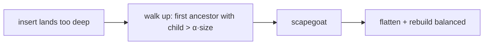

# Scapegoat Trees

## What it is
A **scapegoat tree** (Galperin & Rivest, 1993) is a binary search tree that keeps itself balanced **without storing any balance information** — no colours, heights or priorities — only subtree sizes. Problem 17-3 presents it as an application of amortised analysis: the occasional expensive rebuild is paid for by many cheap operations.

## How it works
A BST is **α-weight-balanced** (`½ < α < 1`) if for every node `x`, `size(x.left) ≤ α·size(x)` and `size(x.right) ≤ α·size(x)`. Such a tree has height `≤ log_{1/α} n`.
* **Insert:** insert as usual; if the new node lands at depth `> log_{1/α}(n)`, walk up to the first ancestor `x` that is **not** α-weight-balanced — the **scapegoat** — and **rebuild** the subtree rooted at `x` into a perfectly balanced tree in `Θ(size(x))` time (flatten in-order, rebuild from the middle).
* **Delete:** delete as usual; if `n < α·max_n` rebuild the *whole* tree and set `max_n = n`.
* **Why amortised `O(lg n)`:** use the potential `Φ(x) = |size(x.left) − size(x.right)|` summed over nodes (≥ 0, 0 for a rebuilt perfect tree). A scapegoat has `Ω(size)` imbalance, so the `Θ(size)` rebuild is paid for by a potential drop of the same order, and each insert or delete raises `Φ` by at most `O(lg n)`.

## Complexity
Search `O(lg n)` worst case; insert and delete `O(lg n)` amortised. Space `n` nodes plus one size field each.

## When to use it
When per-node memory must stay minimal and amortised bounds are acceptable. Compare other balancing schemes: [red-black](#/red_black_tree), [AVL](#/avl_tree) (worst-case guarantees, extra fields) and [treaps](#/treap) (random priorities).

## In this implementation
α = 0.7; sizes are maintained on the insertion path, rebuilds use `flatten`/`build`. Tests compare with `BTreeSet` under 6000 random operations, check the size fields and the `log_{1/α}` height bound at every step, and that sorted insertions trigger rebuilds yet end with height < 40 for 20 000 keys.
