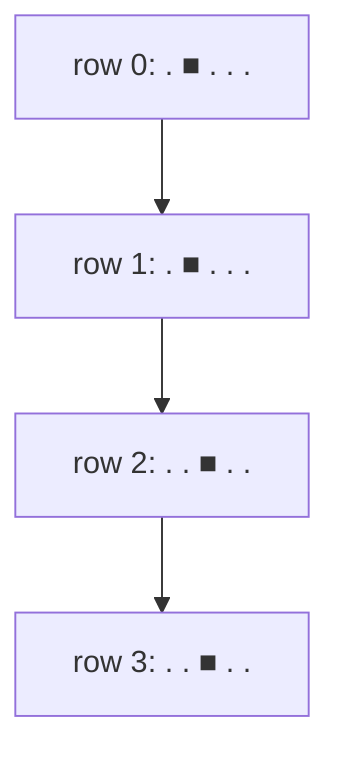

# Image Compression by Seam Carving

## What it is
To shrink a picture without squashing important content, **seam carving** (Avidan & Shamir) repeatedly deletes a *seam*: one pixel per row, with consecutive pixels in adjacent columns, chosen to minimise the sum of per-pixel "disruption" measures. Problem 15-8 formulates the seam search as a dynamic program.

## How it works
Let `best[i, j]` be the cheapest seam ending at pixel `(i, j)`:

`best[i,j] = d[i,j] + min( best[i−1, j−1], best[i−1, j], best[i−1, j+1] )`.

The last row's minimum gives the cost; backtrack through the argmins to read the seam. Delete it, recompute disruptions near the seam, and repeat to remove as many columns as desired. (The problem also asks for the extension to *non-negative* constraints on how much the seam may bend.)

## Complexity
Θ(mn) time and space per seam for an `m × n` image.

## When to use it
Content-aware image resizing, video retargeting, and any "min-cost monotone path through a grid" (e.g. dynamic time warping, route planning on a layered DAG).

## In this implementation
`min_seam` returns the cost and the column of the seam in each row; `remove_seam` produces the carved grid. Randomised tests compare with exhaustive recursion.
