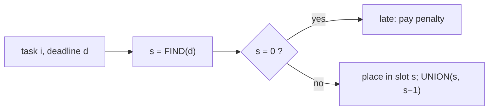

# Scheduling Unit-Time Tasks with Disjoint Sets

## What it is
Section 16.5 shows that scheduling `n` unit-time tasks, each with a deadline and a penalty if it misses it, is a **matroid** problem: greedily keep tasks in decreasing order of penalty as long as the kept set stays schedulable ([matroid greedy](#/matroid_greedy)). Testing independence naively costs `O(n)` per task, so `O(n²)` in all. Problem 16-4 shows how a [disjoint-set forest](#/disjoint_set) brings the scheduling phase down to almost linear time.

## How it works
Process tasks in **decreasing penalty**. Task `i` with deadline `d_i` is placed in the **latest free time slot not after `d_i`** (an early slot may be needed by a task with an earlier deadline, but the later ones are never needed by it — so taking the latest free slot never hurts). If no free slot exists the task is *late* and pays its penalty.

Finding "the latest free slot ≤ d" is the union-find problem: keep slots `0, 1, …, n` in sets such that each *free* slot is the representative of its set, together with the occupied slots just above it. `FIND(d)` returns the answer; slot `0` is a sentinel meaning "none free". When slot `s` becomes occupied, `UNION(s, s − 1)` merges it into the set of the slot below. With union by rank and path compression each operation is `O(α(n))`.

## Complexity
`O(n lg n)` for the sort plus `O(n α(n))` for the placements, versus `O(n²)` with a linear slot search.

## When to use it
Job scheduling with hard unit-length slots (ad slots, lab sessions, appointment systems) and any "assign each item to the latest available position before its limit" problem — the same trick drives offline **interval colouring** and the *Kruskal-like* matroid algorithms.

## In this implementation
Tests compare the total late penalty with the matroid algorithm in [`matroid_greedy`](#/matroid_greedy) on 300 random instances and check that slot assignments are valid (distinct slots, not after the deadline), then verify optimality against exhaustive search over all kept-task subsets on 100 small cases. The demo schedules 200 000 tasks instantly.
