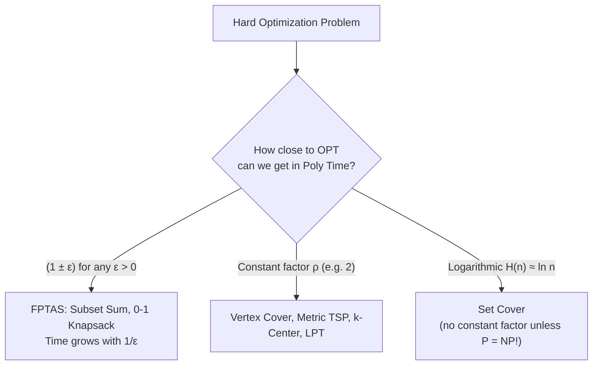

# Approximation Algorithms

## Introduction
So you proved the problem your boss wants solved is NP-complete—now what? You can't just shrug and say "wait $2^n$ years"! **Chapter 35 of CLRS** (`Ch. 37` in 1e) shows how to design **fast polynomial-time algorithms with a mathematical guarantee**: instead of finding the 100% optimal answer, you prove your solution is **always within factor $\rho$** of the true optimum (e.g., at most $2\times$ optimal cost, or at least $(1-\varepsilon)\times$ optimal profit), even on adversarial inputs!

## What Problem Is It Solving?
- **Constant-factor approximations ($\rho = 2$):** Fast combinatorial or LP-rounded solutions within $2\times$ of OPT ([Vertex Cover 2-Approx](#/approx_vertex_cover), [Metric TSP 2-Approx](#/approx_tsp), [Weighted Vertex Cover by LP Rounding](#/lp_rounding_vertex_cover), [k-Center Clustering](#/k_center), [Parallel Machine Scheduling](#/list_scheduling), [Maximal Matching](#/weighted_cover_knapsack_ptas)).
- **Logarithmic approximation where constant is impossible:** Cover all elements cleanly within $H(n) \approx \ln n$ of OPT ([Greedy Set Cover](#/greedy_set_cover), [Weighted Set Cover](#/weighted_cover_knapsack_ptas)).
- **Arbitrarily close to optimal — FPTAS ($(1+\varepsilon)$ / $(1-\varepsilon)$):** Trade runtime polynomial in $1/\varepsilon$ for near-exact answers ([Subset Sum FPTAS](#/approx_subset_sum), [0-1 Knapsack FPTAS](#/weighted_cover_knapsack_ptas)).
- **Coin-flip & derandomized approximations:** Hit $7/8$ of clauses in MAX-3-CNF or $1/2$ of edges in MAX-CUT simply by flipping coins—then remove randomness deterministically ([Randomized Approximation](#/randomized_approximation)).

## Algorithms & Trade-Offs

| Algorithm | Ratio $\rho$ | Runtime | Prerequisite | Key Trade-Off |
|---|---|---|---|---|
| [Vertex Cover (Maximal Matching)](#/approx_vertex_cover) vs. [LP Rounding](#/lp_rounding_vertex_cover) | **2-approx** (both) | $O(V + E)$ vs. LP solve | Unweighted vs. **Weighted** vertices | Picking both endpoints of a maximal matching is linear-time and super simple, **but** ignores vertex weights! LP rounding (`x_v >= 0.5`) handles arbitrary weights while keeping the factor-2 guarantee. |
| [Metric TSP (MST + Preorder)](#/approx_tsp) vs. General TSP | **2-approx** (1.5 with Christofides) | $O(V^2)$ / $O(E \lg V)$ | **Triangle inequality** must hold | If distances satisfy $d(u,w) \le d(u,v)+d(v,w)$, doubling an MST gives a fast 2-approximation; **without** triangle inequality, *no* constant-factor poly-time approximation exists unless $\mathbf{P}=\mathbf{NP}$! |
| [Greedy Set Cover](#/greedy_set_cover) / [Weighted Set Cover](#/weighted_cover_knapsack_ptas) | **$H(d) \le \ln n + 1$** | $O(\sum \|S_i\|)$ | Any sets | Notice the counterintuitive trap: greedy works remarkably well ($H(n)$), **yet** you cannot beat $(1-o(1))\ln n$ unless $\mathbf{P}=\mathbf{NP}$! |
| [FPTAS for Subset Sum](#/approx_subset_sum) & [0-1 Knapsack](#/weighted_cover_knapsack_ptas) | **$(1 \pm \varepsilon)$** | $O(n^2/\varepsilon)$ or $O(n^3/\varepsilon)$ | Tolerance $\varepsilon > 0$ | Trimming close numbers or rounding item values trades exactness for speed: smaller $\varepsilon$ gives tighter accuracy at $O(1/\varepsilon)$ polynomial cost. |
| [List Scheduling](#/list_scheduling) vs. LPT (sorted jobs) | $2 - 1/m$ vs. **$4/3 - 1/(3m)$** | $O(n \lg m)$ | Identical parallel machines | Scheduling jobs in arrival order can waste up to $2\times$ makespan; simply sorting longest-job-first (`LPT`) tightens the guarantee cleanly to $4/3$. |
| [MAX-3-CNF & MAX-CUT](#/randomized_approximation) | $7/8$ and $1/2$ | $O(n + m)$ | None | Simply assigning variables uniformly at random satisfies $7/8$ of 3-SAT clauses in expectation—and conditional expectation derandomizes it deterministically! |

## Quick Rules of Thumb for CS Students
- **How do you bound an optimum you can't compute?** You compare your solution against a **lower bound** on OPT (e.g., maximal matching size $\le |\text{VC}^*|$, MST weight $\le \text{TSP}^*$, or LP relaxation optimum $\le \text{ILP}^*$).
- **Triangle inequality changes everything:** With it, Metric TSP has clean 2-approx and 1.5-approx tours; without it, even finding *any* $2^n$-factor approximation is NP-hard!
- **Watch what makes an FPTAS possible:** Problems with pseudopolynomial DP solutions ([Subset Sum](#/approx_subset_sum), [Knapsack](#/weighted_cover_knapsack_ptas)) often convert into FPTASes by scaling and rounding the DP table dimensions.
