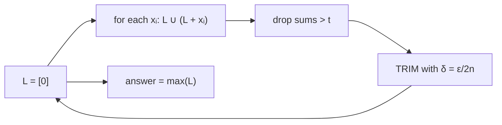

# FPTAS for Subset Sum

## What it is
Some NP-hard optimisation problems have approximation algorithms that get arbitrarily close to optimal. A **polynomial-time approximation scheme (PTAS)** gives a `(1+ε)`-approximation in time polynomial in the input size for every fixed `ε > 0`; if the time is polynomial in `1/ε` too it is a **fully polynomial-time approximation scheme (FPTAS)**. The optimisation version of [subset sum](#/subset_sum_np) — find a subset with the largest sum not exceeding `t` — has an FPTAS (Section 35.5).

## How it works
**Exact algorithm:** keep the list `Lᵢ` of all reachable sums ≤ `t`: `Lᵢ = Lᵢ₋₁ ∪ (Lᵢ₋₁ + xᵢ)`. The list can double each step — exponential.

**Trimming:** with a parameter `δ`, remove from the sorted list every element `y` that is within a factor `1+δ` of a smaller element `z` still in the list (`z ≤ y ≤ (1+δ)z`) — `z` is a good *representative* for `y`. Choose `δ = ε/2n`. After trimming, consecutive elements differ by more than a factor `1+δ`, so a list holds only `O(ln t / δ) = O(n ln t / ε)` elements.

**Error:** each of the `n` trimming steps loses at most a factor `1+ε/2n`, so the final answer `z*` satisfies `OPT/z* ≤ (1+ε/2n)ⁿ ≤ e^{ε/2} ≤ 1+ε`.

## Complexity
`O(n² ln t / ε)` time — polynomial in `n`, `lg t` and `1/ε`.

## When to use it
Packing and budget problems where an answer within 1 % is acceptable but instances are too big for exact methods; the same trimming idea underlies FPTASes for [knapsack](#/knapsack_01).

## In this implementation
`exact_subset_sum`, `trim` and `approx_subset_sum` (also reporting the longest list encountered). Tests verify `(1−ε)·OPT ≤ z ≤ t` and the list-size bound on 100 random instances for three values of ε.
