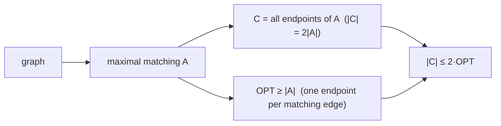

# Approximate Vertex Cover

## What it is
A **vertex cover** of an undirected graph is a set of vertices touching every edge; finding a *minimum* cover is NP-hard. When exact solutions are out of reach, an **approximation algorithm** runs in polynomial time and guarantees a solution within a factor `ρ(n)` of optimal. Chapter 35 (37 in the 4th edition) begins with this 2-approximation.

## How it works
```
APPROX-VERTEX-COVER(G):
  C = ∅;  E′ = G.E
  while E′ ≠ ∅:
      pick any edge (u, v) ∈ E′
      C = C ∪ {u, v}
      remove from E′ every edge incident on u or v
  return C
```
**Why it is a 2-approximation (Theorem 35.1).** The chosen edges `A` form a *maximal matching*: no two share an endpoint. Any cover — in particular the optimal one `C*` — must contain at least one endpoint of every edge in `A`, and those endpoints are distinct, so `|C*| ≥ |A|`. The algorithm returns `|C| = 2|A| ≤ 2|C*|`.


The ratio 2 is tight (complete bipartite graphs) and no better constant is known in polynomial time (unless the Unique Games Conjecture fails, 2 is optimal).

## Complexity
`O(V + E)` time.

## When to use it
Quickly covering networks with monitors, guards or sensors; a building block for problems that reduce to cover ([clique](#/np_reductions)). For weighted instances use [LP rounding](#/lp_rounding_vertex_cover).

## In this implementation
Edge-order greedy matching; the tests check cover validity, `|C| ≤ 2·OPT` against exact enumeration, and that the bound is tight on `K_{5,5}`.
