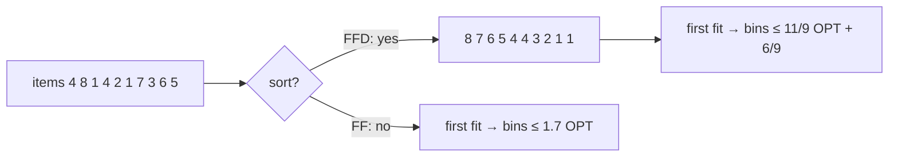

# Bin Packing: First Fit

## What it is
Given items with sizes `s₁,…,sₙ` and bins of capacity `C`, pack all items into as few bins as possible. The decision version is NP-complete (it contains [PARTITION / subset sum](#/subset_sum_np)), so Problem 35-1 studies approximation algorithms with provable guarantees.

## How it works
* **Next Fit:** keep one open bin; if the next item does not fit, close it and start a new one.
* **First Fit:** place each item in the *first* bin with enough room (open a new one if none).
* **Best Fit:** use the *fullest* bin that still fits the item.
* **First Fit Decreasing (FFD):** sort items by decreasing size, then First Fit.

**Guarantees.** Any two consecutive bins of First Fit/Next Fit hold more than `C` in total (otherwise the later items would have gone in the earlier bin), so after pairing them off the algorithms use fewer than `2⌈Σsᵢ/C⌉ ≤ 2·OPT` bins — a **2-approximation** (Problem 35-1(c)). A finer analysis gives First Fit ≤ `1.7·OPT` and **FFD ≤ (11/9)·OPT + 6/9** (Johnson 1973; tight). Bin packing admits an asymptotic PTAS.

## Complexity
First Fit and Best Fit: `O(n lg n)` with a balanced tree over bin capacities (`O(n²)` here); Next Fit: `O(n)`.

## When to use it
Memory allocation and container loading, VM placement, file backup onto discs, cutting stock (1-D). In practice FFD is the default heuristic.

## In this implementation
Capacities and sizes are integers. Tests compare all four heuristics against a branch-and-bound **exact optimum** on 200 random instances: validity of each packing, the factor-2 guarantee, and `9·FFD ≤ 11·OPT + 6`.
