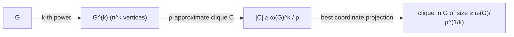

# Approximating the Size of a Maximum Clique (Graph Powers)

## What it is
CLIQUE is NP-complete, so one asks how well its size `ω(G)` can be approximated in polynomial time. Problem 35-2 shows an astonishing **self-reduction**: if there is a polynomial-time approximation algorithm with a *constant* ratio `ρ` for maximum clique, there is one with ratio `ρ^(1/k)` for any `k` — hence a **polynomial-time approximation scheme**. (Combined with the PCP theorem this is the route to proving that no constant-factor approximation exists unless P = NP — in fact CLIQUE is hard to approximate within `n^(1−ε)`.)

## How it works
Define the **`k`-th power** `G^(k)`: its vertices are `k`-tuples of vertices of `G`, and two distinct tuples are adjacent iff in **every** coordinate their entries are equal or adjacent in `G`. Then

`ω(G^(k)) = ω(G)^k`.

* (`≥`) the Cartesian product of a clique of `G` with itself `k` times is a clique of `G^(k)`.
* (`≤`) project a clique of `G^(k)` onto each coordinate: every projection is a clique of `G`, and the clique is contained in the product of its projections, so its size is at most `ω(G)^k`.

Given an approximate clique `C` of `G^(k)` with `|C| ≥ ω(G^(k))/ρ = ω(G)^k/ρ`, the projection with the most distinct vertices has at least `|C|^{1/k} ≥ ω(G)/ρ^{1/k}` vertices and is a clique of `G`. The price is that `G^(k)` has `n^k` vertices — fine for a fixed `k`, which is why the result is a PTAS-type argument rather than a practical algorithm.

## Complexity
Building `G^(k)` takes `n^{2k}` time; the approximation ratio improves from `ρ` to `ρ^{1/k}`.

## When to use it
Conceptually, as the textbook example of **gap amplification** by graph products — the same idea appears in hardness proofs for independent set, chromatic number and set cover.

## In this implementation
Graphs of up to 7–8 vertices are stored as bitmasks. Tests check `ω(G²) = ω(G)²` on 80 random graphs (with an exact branch-and-bound clique routine), and that the clique recovered from a maximum clique of `G²` is a real clique of `G` of size at least `√|C|`.
