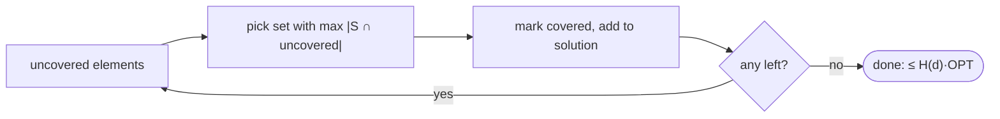

# Greedy Set Cover

## What it is
Given a universe `X` and a family `F` of subsets whose union is `X`, the **set-covering problem** asks for the fewest subsets of `F` covering `X`. It models placing facilities, choosing test suites, or hiring a team with all required skills, and is NP-hard (it generalises [vertex cover](#/approx_vertex_cover)).

## How it works
Greedy rule: repeatedly pick the set that covers the **most uncovered elements**.

**Guarantee (Theorem 35.4).** The greedy cover has size at most `H(d)·|C*|`, where `d` is the size of the largest set and `H(d) = 1 + 1/2 + … + 1/d ≤ ln d + 1`. Proof by *charging*: when a set `S` covers `k` new elements, give each of them cost `1/k`; the total cost equals the number of chosen sets. For any set `S ∈ C*`, the elements of `S` are charged at most `H(|S|)` in total (the `j`-th last element of `S` to be covered costs at most `1/j`, since `S` itself was a candidate). Summing over `C*` gives `|C| ≤ Σ_{S∈C*} H(|S|) ≤ |C*|·H(d)`.

This logarithmic factor is essentially optimal: unless P = NP, no polynomial algorithm beats `(1 − o(1)) ln n`.

## Complexity
`O(Σ|S|)` with bucket queues (naively `O(|X|·|F|·min(|X|,|F|))`).

## When to use it
Sensor/facility placement, test-case selection, feature selection, set-based scheduling; also as the rounding-free alternative to LP-based covers.

## In this implementation
Tests check that the greedy output covers the universe and respects the `H(d)` bound against exhaustive search on 300 random instances; a classic family shows greedy can exceed the optimum.
