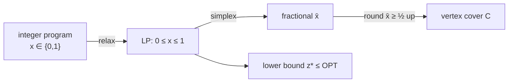

# Weighted Vertex Cover by LP Rounding

## What it is
For *weighted* vertex cover (each vertex has a cost `w(v)`) the maximal-matching trick of [APPROX-VERTEX-COVER](#/approx_vertex_cover) no longer works. Section 35.4 introduces a powerful general technique: **relax the integer program to a linear program, solve it exactly with [simplex](#/simplex), and round the fractional solution**.

## How it works
The 0-1 integer program: minimise `Σ w(v)x(v)` s.t. `x(u) + x(v) ≥ 1` for every edge, `x(v) ∈ {0,1}`. NP-hard. **Relax** `x(v) ∈ {0,1}` to `0 ≤ x(v) ≤ 1` — an LP solvable in polynomial time, whose optimum `z*` satisfies `z* ≤ w(C*)` (every integral cover is a feasible fractional one).

**Rounding rule:** `C = { v : x̄(v) ≥ ½ }`.
* *Feasible*: for every edge, `x̄(u) + x̄(v) ≥ 1` forces at least one of them to be ≥ ½.
* *Cost*: `z* = Σ w(v)x̄(v) ≥ Σ_{v∈C} w(v)·½ = ½ w(C)` ⇒ `w(C) ≤ 2z* ≤ 2·w(C*)`.

For a triangle with unit weights the LP optimum is 1.5 (all `x = ½`) whereas the integral optimum is 2 — the **integrality gap**.

## Complexity
Polynomial: one LP with `|V|` variables and `|E| + |V|` constraints (plus a linear-time rounding pass).

## When to use it
The LP-relaxation-and-rounding paradigm applies to set cover, facility location, scheduling and network design; the LP value also gives a quality certificate (lower bound) for branch-and-bound solvers.

## In this implementation
Uses this repository's own simplex implementation (with its two-phase start for the `≥` constraints). Tests assert `LP ≤ OPT`, `weight ≤ 2·LP` and cover validity across 150 random weighted graphs.
