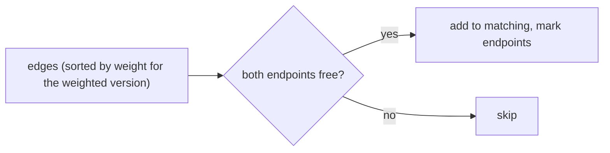

# Approximating Maximum Matching

## What it is
A **matching** is a set of edges no two of which share a vertex. Maximum-cardinality matching and maximum-weight matching are both solvable exactly in polynomial time (Edmonds' blossom algorithm for general graphs; [Hopcroft–Karp](#/hopcroft_karp), [flows](#/maximum_bipartite_matching) and the [Hungarian algorithm](#/hungarian) for bipartite ones) — but those algorithms are intricate. Problem 35-4 asks for simple greedy algorithms with provable ratios.

## How it works
* **Maximal matching.** Scan the edges once and take every edge whose two endpoints are still free: `O(V + E)`. The result is *maximal* (no edge can be added). Every edge of a maximum matching `M*` must touch a vertex covered by the maximal matching `M` (otherwise `M` could be extended), and each edge of `M` covers only two vertices, hence touches at most two edges of `M*`: **`|M*| ≤ 2|M|`**. The factor 2 is tight (a path with 3 edges). The endpoints of a maximal matching also form a 2-approximate vertex cover — exactly the algorithm of [APPROX-VERTEX-COVER](#/approx_vertex_cover).
* **Maximum weight.** Take edges in order of **decreasing weight**, skipping those that touch already matched vertices. Each greedy edge `e` "blocks" at most two optimal edges, both of weight at most `w(e)`, so **`w(M) ≥ ½ w(M*)`**.

## Complexity
`O(E)` for a maximal matching; `O(E lg E)` for the weighted greedy.

## When to use it
Very large graphs where an exact matching is too slow (streaming, distributed — greedy matching is the basis of many parallel matching and graph-coarsening heuristics, e.g. in multilevel graph partitioning), and as a starting solution for exact augmenting algorithms.

## In this implementation
Tests compare both greedy algorithms with the exhaustive optimum over all edge subsets on 400 random multigraphs (self-loops and parallel edges allowed): the factor-2 guarantees hold, matchings are valid and maximal, and a 3-edge path shows the ratio is tight.
