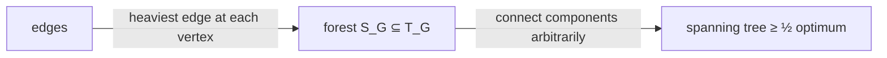

# Approximating a Maximum Spanning Tree

## What it is
A **maximum** spanning tree is found exactly by [Kruskal's](#/mst_kruskal) or [Prim's](#/mst_prim) algorithm run with the order of weights reversed. Problem 35-6 shows that a simple *local* rule gets within a factor of two **in linear time**, without sorting. Let `G` have distinct edge weights. For every vertex `v`, `max(v)` is the heaviest edge incident on `v`; `S_G` is the set of all of them, and `T_G` the maximum spanning tree.

## How it works
* **`S_G ⊆ T_G`** (cut property): the heaviest edge leaving `{v}` is safe for any forest not containing it — so `S_G` is a forest (it can have no cycle), possibly with several components.
* **`w(T_G) ≤ 2·w(S_G)`.** Root `T_G` anywhere. Each non-root vertex `v` has a parent edge of weight at most `w(max(v))`. Summing, `w(T_G) ≤ Σ_v w(max(v))`, and since an edge of `S_G` can be `max(v)` for at most **two** vertices, `Σ_v w(max(v)) ≤ 2·w(S_G)`.
* **Algorithm.** Compute `S_G` in one pass over the edges (`O(V + E)`), then add arbitrary edges joining different components until the forest becomes a spanning tree (a second linear pass with union-find). The result contains `S_G`, so its weight is `≥ w(S_G) ≥ w(T_G)/2`: a **2-approximation**. The same one-heaviest-edge-per-vertex step is the first round of [Borůvka's algorithm](#/boruvka).

## Complexity
`O(V + E)` (plus the near-constant union-find factor), versus `O(E lg V)` for the exact algorithm.

## When to use it
Very large or streaming graphs where one cheap pass matters more than optimality, and as the seed solution for local search; it also illustrates how **greedy local choices** can approximate a global optimum.

## In this implementation
Weights are distinct (random permutations in the tests). Tests check, on 300 random connected graphs, that `S_G ⊆ T_G`, that `w(T_G) ≤ 2·w(S_G)`, that the produced edge set is a spanning tree and at least half the optimum, and the book's two example shapes: a path with weights 1, 3, 2 (`S_G = T_G`) and two heavy edges joined by a light one (`S_G ≠ T_G`).
