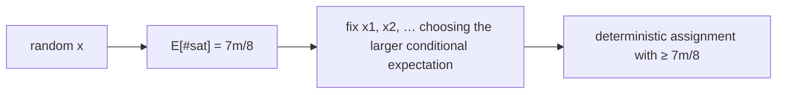

# Randomized Approximation: MAX-3-CNF & MAX-CUT

## What it is
A **randomized approximation algorithm** has an *expected* approximation ratio. For **MAX-3-CNF satisfiability** — satisfy as many clauses of a 3-CNF formula as possible, an NP-hard optimisation version of [SAT](#/cnf_sat) — the simplest possible algorithm already achieves ratio `8/7`.

## How it works
**Random assignment.** Set each variable independently to true or false with probability ½. A clause with three literals on distinct variables is unsatisfied only if all three literals are false: probability `(1/2)³ = 1/8`. By **linearity of expectation** (indicator variables, as in the [hiring problem](#/hire_assistant)) the expected number of satisfied clauses is `7m/8`. Since `OPT ≤ m`, the expected ratio is at most `8/7`; and this is optimal unless P = NP (Håstad).

**Derandomisation by conditional expectations.** Fix the variables one by one, each time choosing the value that does *not decrease* the conditional expected number of satisfied clauses (given the partial assignment, free variables remain fair coins). Because the expectation is an average of its two conditional expectations, one choice is always ≥ the average, so the final deterministic assignment satisfies at least `7m/8` clauses.

**MAX-CUT** (Problem 35-3): put each vertex on a random side; each edge is cut with probability ½, so the expected cut has `|E|/2` edges. A local-search variant (flip vertices with more uncut than cut edges) also guarantees `≥ |E|/2`.

## Complexity
Random assignment `O(n)`; derandomisation `O(n·m)`.

## When to use it
Baselines and warm starts for SAT/MAX-SAT solvers, rounding schemes in approximation algorithms (randomised rounding of LPs), and as a model of the probabilistic method in existence proofs.

## In this implementation
Tests confirm the empirical expectation `≈ 7m/8`, the deterministic guarantee `8s ≥ 7m` on 100 random formulas, and that local search cuts at least half the edges.
