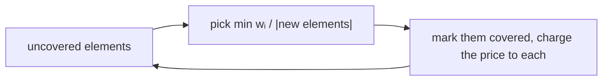

# Weighted Set Cover

## What it is
Given a universe `X` and sets `S₁,…,S_m ⊆ X`, each with a **weight** `w_i ≥ 0`, find a collection of sets covering `X` of **minimum total weight**. The unweighted case (all `w_i = 1`) is the [greedy set cover](#/greedy_set_cover) of Section 35.3; Problem 35-3 asks you to show that the greedy rule still gives an `H(d)`-approximation when sets have weights, where `d = max |S_i|` and `H(d) = 1 + 1/2 + ⋯ + 1/d ≤ ln d + 1`.

## How it works
Repeatedly choose the set with the smallest **cost per newly covered element**, `w_i / |S_i \ covered|`, until everything is covered. **Analysis by charging.** When a set is chosen, charge each newly covered element the price `w_i / (number newly covered)`. Fix an optimal set `S*`; as its elements are covered (in the order the algorithm covers them), when `S*` still has `k` uncovered elements the greedy price of the elements covered next is at most `w(S*)/k` (since `S*` itself was an available choice at that cost per element). Summing over the elements of `S*` gives at most `w(S*)·H(|S*|)`, and summing over the sets of the optimal cover bounds the total charge by `H(d)·OPT`.

## Complexity
`O(m·|X|)` here (a priority queue gives `O(Σ|S_i|·lg m)`); approximation ratio `H(d) ≤ ln d + 1`, essentially best possible unless P = NP (`(1 − o(1)) ln n`).

## When to use it
Choosing servers/sensors/test suites at minimum cost to cover requirements, covering skill sets with hires, feature selection with costs, and as the model of many *covering integer programs*; combine with [LP rounding](#/lp_rounding_vertex_cover) for other ratios.

## In this implementation
Tests compare the greedy cost with the exhaustive optimum on 300 random weighted instances (checking `greedy ≤ H(d)·OPT`, validity of the cover and that infeasible instances are reported consistently), and check that unit weights reproduce the unweighted behaviour.
