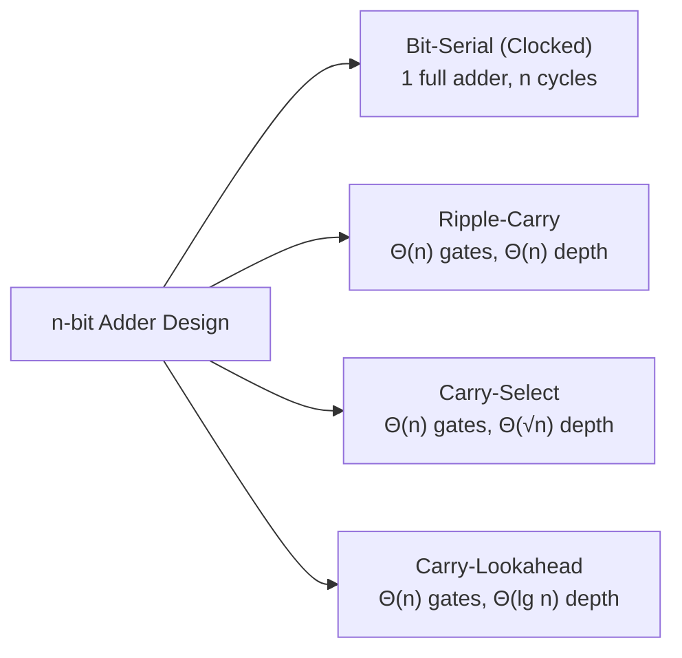

# Arithmetic Circuits

## Introduction
Before writing code in Rust or C, someone had to build the hardware gates that add and multiply two binary numbers inside the CPU's ALU. Covered in the **1st edition of CLRS (Ch. 29)**, this topic bridges computer architecture and algorithm design: instead of counting CPU instructions over time, you build a static DAG of logic gates (`AND`, `OR`, `NOT`) and optimize **size** (number of gates / chip area) versus **depth** (longest path from inputs to outputs = clock delay).

## What Problem Is It Solving?
- **Building basic logic & timing models:** Wire combinational gates without cycles and analyze circuit depth vs. gate count ([Combinational Circuits](#/combinational_circuits)).
- **Fast binary addition ($A + B$):** The naive textbook carry bit ripples from bit $0$ up to bit $n-1$ in $\Theta(n)$ gate delay. Can we compute all carries in parallel in $O(\lg n)$ delay? ([Ripple-Carry Adder](#/ripple_carry_adder), [Carry-Select Adder](#/carry_select_adder), [Carry-Lookahead Adder](#/carry_lookahead_adder), [Bit-Serial Clocked Adder](#/clocked_circuits)).
- **Fast binary multiplication ($A \times B$):** Multiply two $n$-bit numbers by adding $n$ shifted partial products in $O(\lg n)$ delay using carry-save trees ([Carry-Save Adder](#/carry_save_adder), [Array & Wallace-Tree Multipliers](#/multiplier_circuits)).

## Algorithms & Trade-Offs

| Circuit | Gate Size (Area) | Circuit Depth (Delay) | Key Idea & Trade-Off |
|---|---|---|---|
| [Bit-Serial Clocked Adder](#/clocked_circuits) | $\Theta(1)$ gates + 1 flip-flop | $\Theta(n)$ clock cycles | Reuses a single full adder across $n$ clock ticks—minimal silicon area, slowest wall-clock latency. |
| [Ripple-Carry Adder](#/ripple_carry_adder) | $\Theta(n)$ | $\Theta(n)$ | Chains $n$ full adders; tiny size and clean wiring, **but** bit $n-1$ waits linearly for bit $0$'s carry to ripple through. |
| [Carry-Select Adder](#/carry_select_adder) | $\Theta(n)$ (slightly larger) | $\Theta(\sqrt{n})$ | Splits bits into $\sqrt{n}$ blocks that speculatively compute *both* carry-in=`0` and carry-in=`1` sums in parallel, then muxes the true carry—halves/square-roots delay with modest extra gates. |
| [Carry-Lookahead Adder](#/carry_lookahead_adder) | $\Theta(n)$ | **$\Theta(\lg n)$** | Views carry propagation as an associative prefix composition of `(generate, propagate)` pairs! Achieves logarithmic delay while keeping linear gate count. |
| [Carry-Save Adder](#/carry_save_adder) | $\Theta(n)$ | **$O(1)$** (3 inputs → 2 outputs) | Stops carry propagation completely inside intermediate sums by keeping `(sum_bits, carry_bits)` separate until one final addition! |
| [Array Multiplier](#/multiplier_circuits) vs. [Wallace-Tree Multiplier](#/multiplier_circuits) | Both $\Theta(n^2)$ gates | $\Theta(n)$ vs. **$\Theta(\lg n)$** | An array multiplier lines partial products up neatly in a regular 2D grid (easy chip layout, $\Theta(n)$ delay); a Wallace tree stacks $3$-to-$2$ carry-save adders into a tree to multiply in $\Theta(\lg n)$ delay at the cost of irregular wiring. |

## Quick Rules of Thumb for CS Students
- **Circuit depth = parallel span:** Notice the deep connection to [Parallel Algorithms](#/topic/parallel): [Carry-Lookahead](#/carry_lookahead_adder) is literally [Parallel Prefix Scan](#/parallel_prefix) implemented in silicon!
- **Defer carries until the very end:** Whenever you add 3 or more numbers (like $n$ partial products in multiplication), use [Carry-Save](#/carry_save_adder) layers in $O(1)$ delay each and pay for **one** carry-lookahead addition at the bottom.
- **Regularity vs. speed in hardware:** Asymptotically shallower circuits (Wallace trees, lookahead trees) need longer/messier wires on a physical 2D silicon die than ripple or array layouts.
