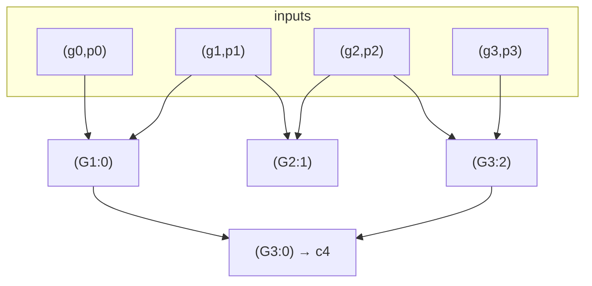

# Carry-Lookahead Adder

## What it is
The [ripple-carry adder](#/ripple_carry_adder) is slow because each carry waits for the previous one. A **carry-lookahead adder** computes all carries *directly* from the inputs, in `O(lg n)` depth. Section 29.2 of the first edition derives it using the key insight that **carry propagation is an associative operation**, hence a [parallel-prefix](#/parallel_prefix) problem.

## How it works
Each bit position is in one of three states, given by two signals:
* **generate** `gᵢ = aᵢ ∧ bᵢ` — creates a carry regardless of the input carry;
* **propagate** `pᵢ = aᵢ ⊕ bᵢ` — passes the incoming carry through;
* otherwise (`aᵢ = bᵢ = 0`) it **kills** the carry.

Combine two adjacent blocks (high ⊗ low): `(G, P) ∘ (G′, P′) = (G ∨ (P ∧ G′),  P ∧ P′)`. The operator is associative, so a prefix network over `(gᵢ, pᵢ)` yields the group generate `G_{i:0} = cᵢ₊₁` for **all** `i` in `⌈lg n⌉` levels. The sum bits are then `sᵢ = pᵢ ⊕ cᵢ`.

## Complexity
Depth `O(lg n)` (here `2⌈lg n⌉ + 3`) at the price of size `Θ(n lg n)` for this Kogge–Stone network (other prefix networks trade depth for fewer gates, e.g. Brent–Kung `2 lg n − 1` levels with `O(n)` gates).

## When to use it
Every high-performance ALU: modern CPUs use lookahead trees, often hybrid (4-bit CLA blocks with a second-level lookahead). It is a canonical example of replacing a sequential dependency by a parallel prefix.

## In this implementation
`build_cla` constructs the Kogge–Stone network on `Circuit` wires; tests verify correctness for random 1–16-bit operands and compare depth against the ripple design (logarithmic vs linear).
