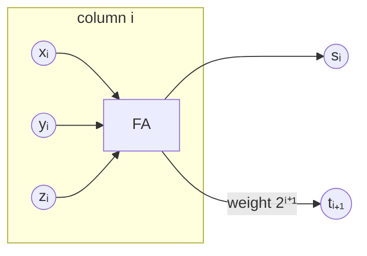

# Carry-Save Adder

## What it is
Adding **three** numbers with ordinary adders needs two carry-propagating additions. A **carry-save adder** (CSA, also called a 3:2 compressor) reduces three `n`-bit numbers `x, y, z` to **two** numbers `s` and `t` with `x + y + z = s + t` in **constant depth**, because no carry is propagated — the carries are *saved* as a separate vector.

## How it works
Use one full adder per bit position *in parallel*:

* `sᵢ = xᵢ ⊕ yᵢ ⊕ zᵢ` (sum, stays in column `i`)
* `tᵢ₊₁ = majority(xᵢ, yᵢ, zᵢ)` (carry, moves to column `i+1`)

Since each full adder reduces three bits of weight `2ⁱ` to one bit of weight `2ⁱ` and one of weight `2ⁱ⁺¹` (the same total value), the identity `x + y + z = s + t` follows.

## Complexity
Size `5n`, depth 3 — independent of `n`. One final carry-propagating adder is still needed to turn `(s, t)` into a single number.

## When to use it
Summing many numbers (multiplier partial products — see the [Wallace tree](#/multiplier_circuits)), multi-operand adders, DSP accumulators (MAC units), and checksum/CRC hardware.

## In this implementation
`build_csa` appends the compressor to a `Circuit`; tests check `s + t = x + y + z` for random inputs and assert constant depth 3.
