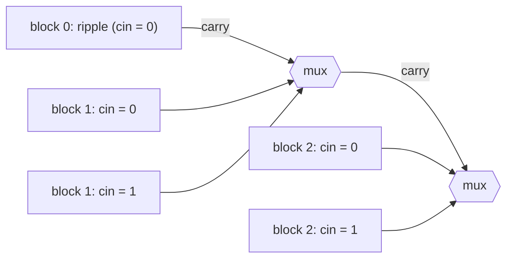

# Carry-Select Adder

## What it is
The [ripple-carry adder](#/ripple_carry_adder) needs time linear in the word length because each stage waits for the carry of the previous one; the [carry-lookahead adder](#/carry_lookahead_adder) computes carries with a parallel-prefix network. The **carry-select adder** is a third classical trade of hardware for time: it **speculates**.

## How it works
Split the `n` bits into blocks of `k` bits. For every block except the lowest, build **two** ripple-carry adders — one assuming carry-in `0`, one assuming carry-in `1` — and run them at the same time as all other blocks. When the real carry arrives from the block below, it merely drives a row of **2:1 multiplexers** choosing the right sum bits and the block's carry-out, which in turn is the select signal for the next block.

With block size `k` the delay is about `2k` (first block's ripple) plus one multiplexer delay per block: `2k + n/k`, minimised at `k ≈ √(n/2)`, giving **`O(√n)`** — between the ripple (`Θ(n)`) and lookahead (`Θ(lg n)`) adders. Using blocks of increasing size, or a tree of selects, reaches `O(lg n)` too. The price is about twice the hardware.

## Complexity
Delay `Θ(√n)` with equal blocks; area `≈ 2n` full adders plus `n` multiplexers.

## When to use it
Mid-range ALUs where lookahead logic is too bulky, FPGA arithmetic (dedicated carry chains resemble ripple), and as the textbook example of **speculative execution** — also the idea behind branch prediction and Brent–Kung style prefix adders.

## In this implementation
Bit vectors are LSB first and the gate-delay model is simple (2 per ripple stage, 1 per multiplexer). Tests compare with native integer addition for 300 random operand pairs and six block sizes, including carry-out, and check that `k = 8` beats the plain ripple adder on a 64-bit worst case.
