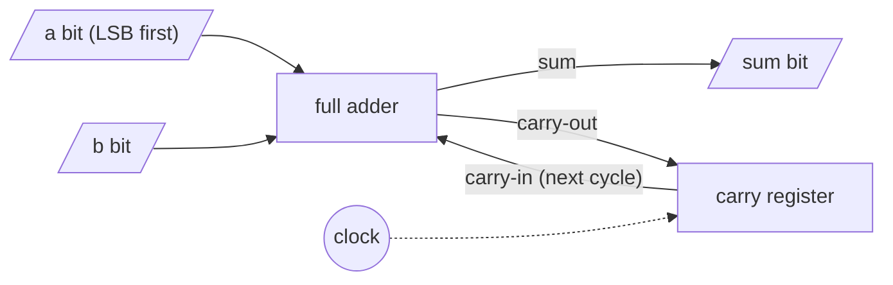

# Clocked Circuits: Bit-Serial Arithmetic

## What it is
A **combinational** circuit has no memory; a **clocked (sequential)** circuit adds **registers** (flip-flops) that latch values on each clock tick, so the same hardware can be reused over many cycles. Section 29.4 of the first edition analyses such circuits by **cycle time** (longest combinational path between registers) and **total latency** (cycles × cycle time) — the trade-off between area and time.

## How it works
* **Bit-serial adder**: instead of `n` [full adders](#/combinational_circuits), use *one* full adder and a one-bit register holding the carry. Feed the operands one bit per cycle, least-significant bit first; after `n` cycles (plus one to flush the carry) the sum has been streamed out. Area `O(1)`, time `Θ(n)` cycles.
* **Shift-and-add multiplier**: a register accumulates `a·2ⁱ` whenever bit `i` of `b` is 1; shift registers present the next bit each cycle: `n` cycles with a single `2n`-bit adder.
* Putting more hardware in each cycle (pipelining, or the book's *linear-array* and *systolic* multipliers) trades area for fewer cycles.

## Complexity
Serial adder: `n + 1` cycles, 1 full adder + 1 flip-flop. Shift-and-add multiplier: `n` cycles with one wide adder. Fully serial multiplier: `Θ(n²)` cycles with `O(1)` adders.

## When to use it
Area-constrained or low-power designs (small FPGAs, DSP filters using distributed arithmetic), communication hardware that receives data serially, and as a teaching bridge from algorithms to RTL (the same recurrences become `always_ff` blocks).

## In this implementation
The adder's register is modelled explicitly (`tick` computes the combinational result then updates the stored carry); cycle counts are exposed so the demo can compare designs.
