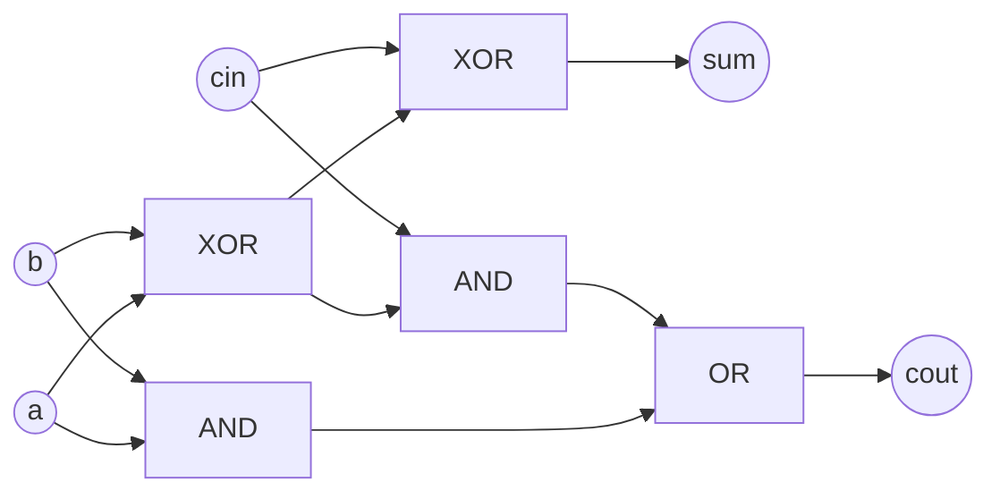

# Combinational Circuits

## What it is
The first edition of CLRS had a chapter on **arithmetic circuits**: it treats hardware as an algorithmic object whose cost measures are **size** (number of gates — chip area) and **depth** (longest input-to-output gate path — propagation delay). The 2nd edition dropped the chapter, but the ideas remain central to digital design.

A **combinational circuit** is an acyclic network of logic gates (AND, OR, NOT, XOR…) whose outputs depend only on the current inputs — no memory, no clock. Contrast with [clocked circuits](#/clocked_circuits).

## How it works
Model the circuit as a DAG: each gate has at most two inputs (bounded fan-in) and its output may feed any number of gates (unbounded fan-out in the book's model). Building blocks:

* **Half adder**: `sum = a ⊕ b`, `carry = a ∧ b` — 2 gates, depth 1.
* **Full adder**: `sum = a ⊕ b ⊕ c`, `carry = ab ∨ (a ⊕ b)c` — 5 gates, sum depth 2, carry depth 3.

## Complexity
Per full adder: size 5, depth 3. Depth is the quantity to minimise: it limits the clock rate. Cascading `n` full adders gives depth `Θ(n)` ([ripple carry](#/ripple_carry_adder)); smarter designs reach `Θ(lg n)` ([carry-lookahead](#/carry_lookahead_adder)).

## When to use it
RTL/gate-level design, timing analysis (critical path = depth), logic synthesis. Software simulation of hardware like this implementation is how functional models are verified.

## In this implementation
`Circuit` records gates in topological order and tracks the depth of each wire; `eval` simulates it. `full_adder` exposes size/depth, tested exhaustively on its 8 input rows.
