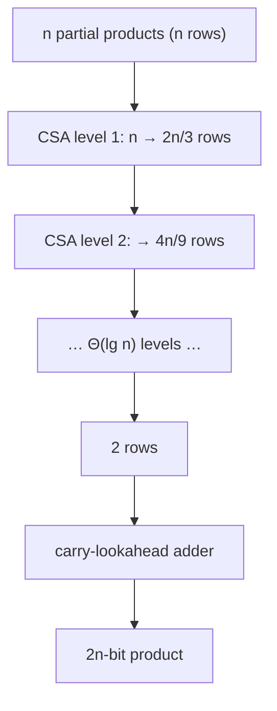

# Array & Wallace-Tree Multipliers

## What it is
Multiplying two `n`-bit numbers produces `n` **partial products** `(a ∧ bᵢ) · 2ⁱ` that must be summed. How they are added determines the circuit's speed.

## How it works
* **Array multiplier**: add the partial products one at a time with [ripple-carry adders](#/ripple_carry_adder) in a regular grid. Simple layout, but the longest path crosses the array: size `Θ(n²)`, depth `Θ(n)`.
* **Wallace-tree multiplier**: view the `n²` partial-product bits as columns by weight. Repeatedly apply **3:2 compressors** ([carry-save adders](#/carry_save_adder)) to groups of three bits in a column, sending the carries to the next column; the maximum column height shrinks by a factor ≈ `3/2` each level, so only `Θ(lg n)` levels reduce `n` rows to 2. A final fast adder ([carry-lookahead](#/carry_lookahead_adder)) produces the product. Size `Θ(n²)`, depth `Θ(lg n)`.

## Complexity
| | Array | Wallace tree |
|---|---|---|
| Size | Θ(n²) | Θ(n²) |
| Depth | Θ(n) | Θ(lg n) |

## When to use it
Wallace/Dadda trees are the standard in high-speed integer and floating-point multipliers; array multipliers are favoured when regular layout matters. Booth recoding halves the number of partial products.

## In this implementation
Both designs are generated as gate-level `Circuit`s and verified exhaustively on random operands up to 8 bits; the demo tabulates size and depth, and a test asserts that for `n = 32` the Wallace depth is less than half the array depth.
